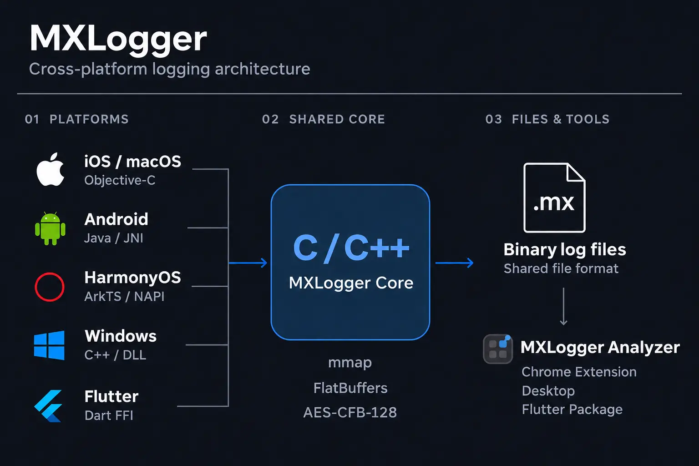
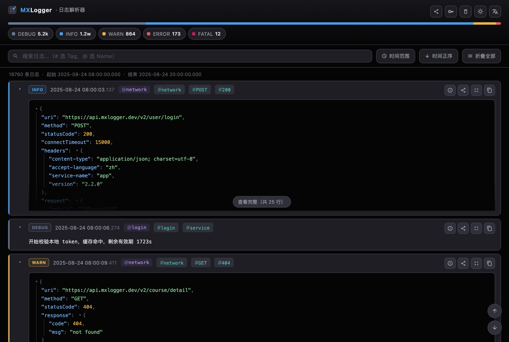
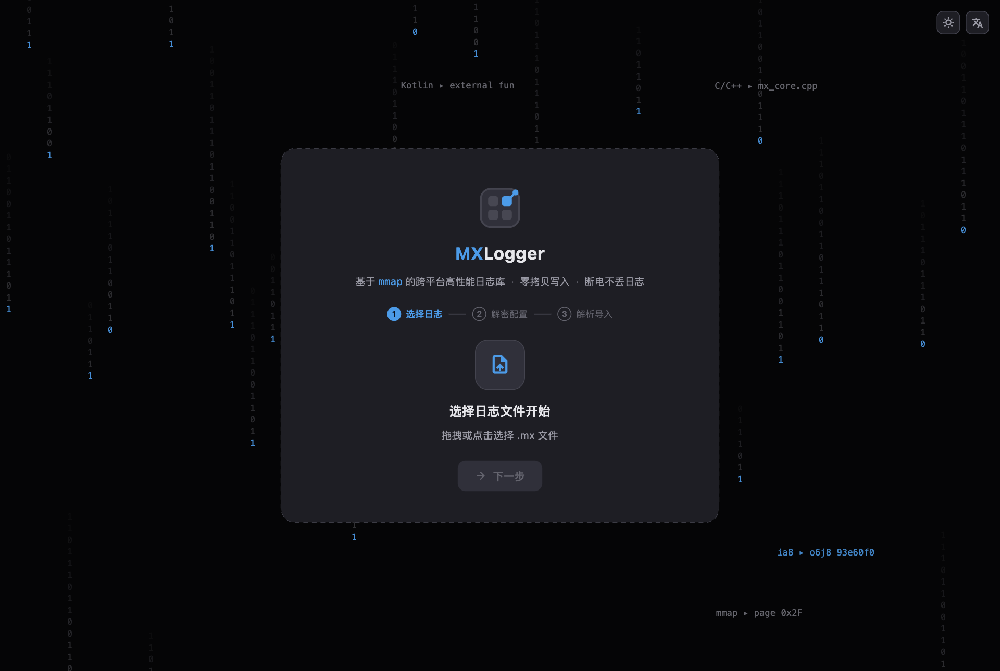
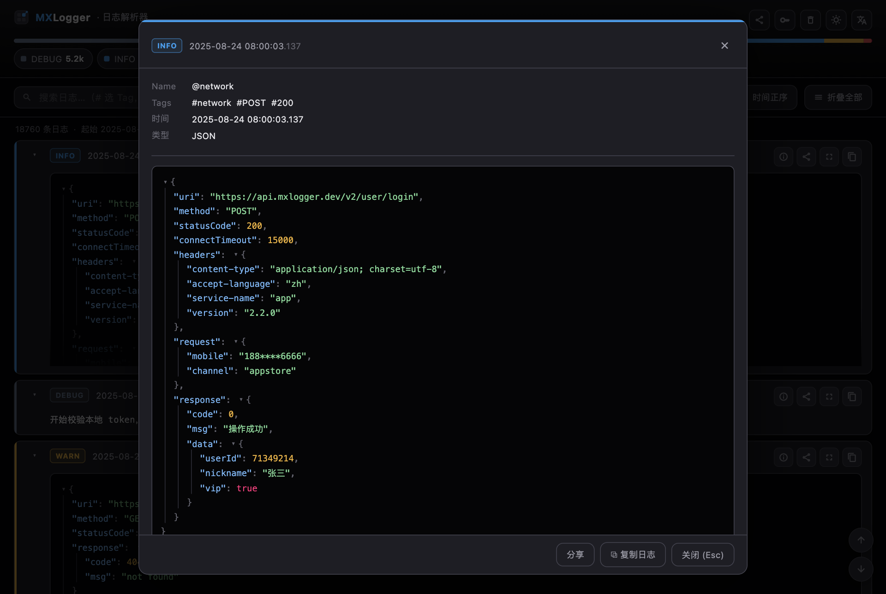
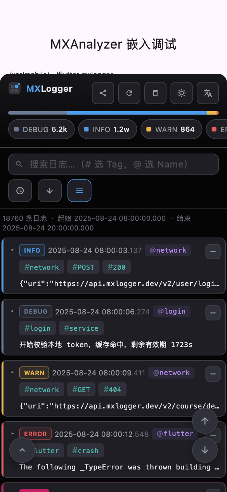
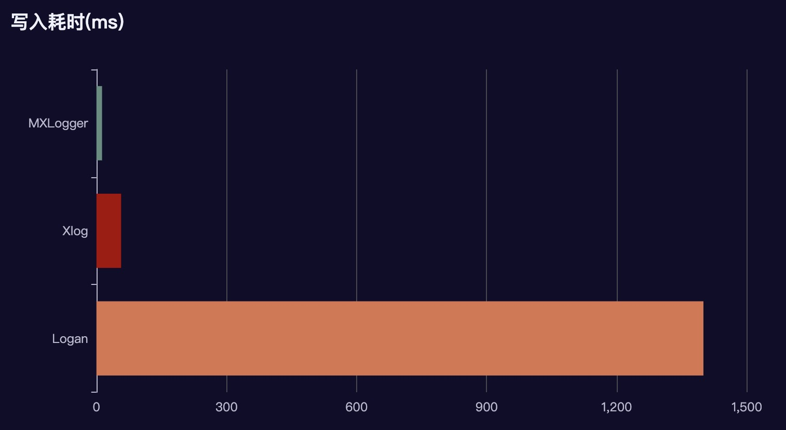

<p align="center">
  
  
  
  
  
</p>

<p align="center">
  
  <a href="https://chromewebstore.google.com/detail/mxlogger-analyzer/bpjhmakllccpeiglbfngmdbelimlghfi"></a>
  <a href="https://pub.dev/packages/mxlogger_analyzer_lib"></a>
</p>

<p align="center">
  <a href="https://github.com/coder-dongjiayi/MXLogger/blob/main/LICENSE.TXT"></a>
  <a href="https://cocoapods.org/pods/MXLogger"></a>
  <a href="https://central.sonatype.com/artifact/io.github.coder-dongjiayi/mxlogger"></a>
  <a href="https://pub.dev/packages/flutter_mxlogger"></a>
</p>

[English](./README.md) | [简体中文](./README_CN.md) | [日本語](./README_JA.md) | [한국어](./README_KO.md)

<p align="center" >

</p>

MXLogger 是基于 **mmap** 内存映射机制的跨平台日志库，支持 **AES-CFB-128** 加密，支持 iOS / macOS / Android /
Windows / HarmonyOS 原生 SDK 和 Flutter 插件。核心代码使用 C/C++ 实现，序列化使用 Google 开源的 **FlatBuffers**，Flutter 端通过 `dart:ffi`
直接调用，性能几乎与原生一致。历史测试中，iPhone 11 写入 10 万条（每条约 134 字节）耗时约 **0.13s**。

配套提供 **mxlogger_analyzer** 日志解析器：导入、解密、检索产出的 `.mx` 二进制日志，支持 Chrome 扩展、
桌面 app（macOS/Windows/Linux），也能以悬浮球的形式直接嵌进你的 iOS/Android Flutter app 里看端上日志。

- [日志解析器](#日志解析器)
- [安装引入](#安装引入)
- [快速开始](#快速开始)
- [API 一览](#api-一览)
  - [iOS](#ios-api) · [Android](#android-api) · [HarmonyOS](#harmonyos-api) · [Flutter](#flutter-api) · [解析器](#analyzer-api)
- [存储策略与日志等级](#存储策略与日志等级)
- [性能测试](#性能测试)
- [注意事项](#注意事项)

## 整体结构



MXLogger 主要解决日志**写入**和日志**分析**两件事。至于日志上报时机应该由业务决定：MXLogger 已经把日志目录
（`diskCachePath`）暴露出来，由开发调用原生平台的文件上传代码传到自己的服务器，下载后再用
mxlogger_analyzer 解析。

---

# 日志解析器

`.mx` 是二进制文件（AES-CFB-128 + flatbuffer），必须用解析器打开。解析器把记录写入 sqlite，基于它提供
全文检索、等级/时间/Tag/Name 过滤和 JSON 语法树查看。

| 形态 | 说明 | 获取方式 |
| --- | --- | --- |
| Chrome 扩展 | 在 Chrome 浏览器中解析 `.mx` 日志 | [从 Chrome 应用商店安装](https://chromewebstore.google.com/detail/mxlogger-analyzer/bpjhmakllccpeiglbfngmdbelimlghfi) |
| 桌面 app | macOS/Windows/Linux 客户端，拖入或选择日志文件即可分析 | [Releases](https://github.com/coder-dongjiayi/MXLogger/releases)（CI 三端出包） |
| 嵌入宿主 app | iOS/Android Flutter app 内的悬浮球 + 底部弹窗 | pub.dev 依赖 `mxlogger_analyzer_lib` |

鸿蒙产出的 `.mx` 文件格式相同，导出后可直接使用 Chrome 扩展或桌面解析器；加密文件需提供相同 KEY/IV。

安装 Chrome 扩展：在 Chrome 中打开上方商店链接，点击「添加至 Chrome」→「添加扩展程序」。
安装后从扩展菜单打开 **MXLogger Analyzer**，选择或拖入 `.mx` 文件，按需填写解密 KEY/IV，然后开始导入。

**数据页**：等级分布条 + 等级 chips、搜索与时间过滤、日志卡片内的 JSON 语法着色树、
`@name` / `#tag` 点击即过滤、单条信息 / 分享 / 全屏 / 复制。右上角可切换深浅主题。



**首次使用三步向导**：① 拖入或选择 `.mx` 文件 → ② 配置解密 KEY/IV（可添加多组，勾选框里的序号就是解密
尝试顺序）→ ③ 真实进度导入。



**单条日志全屏详情**（Esc 关闭）：Name / Tags / 时间 / 等级 + 完整 JSON 树，可整条分享或复制。



**嵌入宿主 app**（手机）：占屏 85% 的底部弹窗——留白收窄、文案让位于图标、等级 chips 横向滚动、
日志卡片默认折叠、四个操作收进「⋯」菜单。

<p align="center">

</p>

解析器完整文档见 [mxlogger_analyzer_lib/README.zh-CN.md](./mxlogger_analyzer/mxlogger_analyzer_lib/README.zh-CN.md)。

---

# 安装引入

## iOS / macOS

**CocoaPods** — 在 `Podfile` 中添加，然后运行 `pod install`：

```ruby
pod 'MXLogger', '~> 2.3.0'
```

**Swift Package Manager** — 在 Xcode 中选择 **File → Add Package Dependencies…**，输入：

```text
https://github.com/coder-dongjiayi/mxlogger-spm.git
```

版本规则选择 **Up to Next Major Version**，起始版本设为 **2.3.0**，将 **MXLogger** 产品添加到 app target。

**Flutter 宿主应用：保留 FFI 符号** — 在 iOS / macOS 宿主应用的 **Runner** target 中，
将 **Release** 和 **Profile** 的 **Build Settings → Strip Style** 设置为
**Non-Global Symbols**，或在这两个构建配置使用的 `.xcconfig` 中添加：

```xcconfig
STRIP_STYLE = non-global
```

使用 SwiftPM 静态链接时，`DynamicLibrary.process()` 会从应用可执行文件中查找
`flutter_mxlogger_*` C 函数。**All Symbols** 可能在归档时删除这些函数的全局符号名，
导致 Debug 正常，而安装 release 包后报 `Failed to lookup symbol 'flutter_mxlogger_initialize'`。
安装及宿主配置见 [Flutter 接入文档](./platform/flutter_mxlogger/README_CN.md#ios--macos)。

## Android

```groovy
implementation 'io.github.coder-dongjiayi:mxlogger:2.3.0'
```

## HarmonyOS (ArkTS)

在业务模块目录（例如 `entry/`）通过 [OHPM 中心仓](https://ohpm.openharmony.cn/)安装：

```sh
ohpm install @djy/mxlogger@2.3.1
```

HAR 包含 ArkTS API 和 ARM64 / x86_64 原生库。声明最低 API 12，目前完成 API 26 / ARM64 真机验证；x86_64 仅完成构建。原生 ArkTS SDK 已发布到 OHPM；当前仓库已提供 Flutter 鸿蒙开发版适配，尚未发布到 pub.dev，详见 [Flutter 接入说明](./platform/flutter_mxlogger/README_CN.md#harmonyos当前仓库开发版)。详见[鸿蒙 SDK、Demo 和打包说明](./platform/OHOS/README.md)。

## Windows

将 `MXLogger.Native.2.3.0.nupkg` 下载到本地源目录（如 `D:\NuGetFeed`），在 Visual Studio 的 Package Manager Console 中运行：

```powershell
Install-Package MXLogger.Native -Version 2.3.0 -Source D:\NuGetFeed
```

包下载及 vcpkg 安装方式见 [Windows SDK 安装说明](platform/Windows/README_CN.md)。

## Flutter

```yaml
dependencies:
  flutter_mxlogger: ^2.3.0
  mxlogger_analyzer_lib: ^2.0.0   # 可选：app 内实时查看日志
```

运行 `flutter pub get`。

---

# 快速开始

## iOS

```objective-c
MXLogger *logger = [MXLogger initializeWithNamespace:@"com.yourdomain.logger"
                                      storagePolicy:MXStoragePolicyYYYYMMDD
                                           fileName:@"mxlog"
                                         fileHeader:@"{\"app_version\":\"2.0.0\"}"
                                           cryptKey:@"abcuioqbsdguijlk"   // 16 字节
                                                 iv:@"bccuioqbsdguijiv"];

logger.consoleEnable = YES;                 // 仅开发期开启，性能测试/线上设为 NO
logger.maxDiskAge   = 60 * 60 * 24 * 7;     // 最多保留 7 天
logger.maxDiskSize  = 1024 * 1024 * 10;     // 最多占用 10M
logger.level        = 0;                    // 0:debug 全部写入文件

// 多个 tag 用英文逗号分隔
[logger debugWithName:@"login" msg:@"开始校验本地 token" tag:@"login,service"];
[logger infoWithName:@"network" msg:responseJSON tag:@"network,POST,200"];
[logger warnWithName:@"network" msg:@"第 2 次重试" tag:@"network"];
[logger errorWithName:@"flutter" msg:stack tag:@"crash"];
[logger fatalWithName:@"database" msg:@"数据库连接丢失" tag:@"db,fatal"];

NSLog(@"日志目录 %@", logger.diskCachePath);
```

## Android

```java
MXLogger logger = MXLogger.initialize(
        context,
        "com.yourdomain.logger",              // nameSpace
        null,                                 // diskCacheDirectory，null 用默认目录
        MXStoragePolicyType.YYYY_MM_DD,
        "mxlog",                              // fileName
        "{\"app_version\":\"2.0.0\"}",        // fileHeader
        "abcuioqbsdguijlk",                   // cryptKey，16 字节
        "bccuioqbsdguijiv");                  // iv

logger.setConsoleEnable(true);
logger.setMaxDiskAge(60 * 60 * 24 * 7);
logger.setMaxDiskSize(1024 * 1024 * 10);
logger.setLevel(0);

// 注意 Android 端 tag 在第一个参数：debug(tag, name, msg)
logger.debug("login,service", "login", "开始校验本地 token");
logger.info("network,POST,200", "network", responseJson);
logger.warn("network", "network", "第 2 次重试");
logger.error("crash", "flutter", stack);
logger.fatal("db,fatal", "database", "数据库连接丢失");

Log.d("MXLogger", "日志目录 " + logger.getDiskCachePath());
```

## HarmonyOS (ArkTS)

在 ArkUI 组件内获取宿主 Context 后初始化：

```typescript
import { MXLogger, MXLogLevel, MXStoragePolicy } from '@djy/mxlogger';

const context = this.getUIContext().getHostContext();
if (!context) { throw new Error('Context unavailable'); }
const logger = MXLogger.initialize(context, {
  nameSpace: 'com.yourdomain.logger',
  storagePolicy: MXStoragePolicy.Daily,
  fileName: 'mxlog',
  fileHeader: '{"app_version":"2.3.0"}',
  cryptKey: 'abcuioqbsdguijlk',
  iv: 'bccuioqbsdguijiv'
});
logger.setLevel(MXLogLevel.Debug);
logger.setMaxDiskAge(7 * 24 * 60 * 60);
logger.setMaxDiskSize(10 * 1024 * 1024);
logger.debug('token check started', { name: 'login', tag: 'login,service' });
logger.info('{"status":200}', { name: 'network', tag: 'network,POST' });
logger.warn('retry #2', { name: 'network', tag: 'network' });
logger.error('request failed', { name: 'network', tag: 'network' });
logger.fatal('connection lost', { name: 'database', tag: 'db,fatal' });
console.info(logger.diskCachePath);
```

默认基础目录为 `context.filesDir/com.mxlog.LoggerCache`，Core 追加 namespace。HiLog 默认关闭，可通过 `setConsoleEnable(true)` 开启。过期清理需主动调用 `removeExpireData()`；共享会话不再使用时调用 `destroy()`。

## Flutter

```dart
final MXLogger logger = await MXLogger.initialize(
  nameSpace: "flutter.mxlogger",
  storagePolicy: MXStoragePolicyType.yyyyMMdd,
  fileHeader: jsonEncode(deviceInfo),
  consoleEnable: true,
  cryptKey: "abcuioqbsdguijlk",   // 16 字节
  iv: "bccuioqbsdguijiv",         // 不填默认与 cryptKey 一致
);

logger.setMaxDiskAge(60 * 60 * 24 * 7);
logger.setMaxDiskSize(1024 * 1024 * 10);
logger.setLevel(0);

logger.debug("开始校验本地 token", name: "login", tag: "login,service");
logger.info(jsonEncode(response), name: "network", tag: "network,POST,200");
logger.warn("第 2 次重试", name: "network", tag: "network");
logger.error(stack, name: "flutter", tag: "crash");
logger.fatal("数据库连接丢失", name: "database", tag: "db,fatal");

debugPrint("日志目录 ${logger.diskcachePath}");
```

---

# API 一览

无需创建 logger 即可读取当前链接的 C++ Core 版本，当前为 `2.3.0`。
Core 版本与各平台封装包版本独立，各 Demo 会动态展示该值。

| 平台 | 调用方式 |
|---|---|
| Windows / C++ | `mx_logger::version()` |
| iOS / macOS（Objective-C） | `[MXLogger coreVersion]` |
| iOS / macOS（Swift） | `MXLogger.coreVersion()` |
| Android（Java/Kotlin） | `MXLogger.coreVersion()` |
| HarmonyOS (ArkTS) | `MXLogger.coreVersion()` |
| Flutter（原生平台） | `MXLogger.coreVersion()` |

各 SDK 共通的两个概念：一个 logger 由 **nameSpace + diskCacheDirectory** 唯一确定，底层 C++ 对象按这一对
去重；这一对的 md5 就是 **loggerToken**——大型 app 组件化时把它传给子模块，子模块用类方法写日志，不必传
logger 对象。

鸿蒙支持同进程共享会话，多进程并发写入尚未验收；初始化的 `directory` 参数为绝对基础目录。

原生 macOS Core 支持多个进程协作访问同一日志目录：写入前获取目录级文件锁，刷新有效长度和
映射容量；不逐条检查路径是否被外部删除或替换。读取时复制有效数据快照后解锁解析。各进程须使用本协议及一致的加密参数，
实际目录必须共享且可访问。不同日志目录互不阻塞；iOS、Android 保持原来的文件访问流程，
Windows Core 使用 `LockFileEx` 协调同目录多进程访问，可以在连续写入间保留映射，
活动文件保护由独立的协调文件锁维持。原生和 Flutter Windows 接入均由手动触发的 `verify-logger` CI 验证；
Flutter 使用预编译 DLL。

macOS / Windows Core 的 `.mxlogger.lock` 是协调文件，不计入日志列表或大小，也不会被清理；logger 存活时请勿手动删除。
过期/容量清理、`removeBeforeAllData` 和 `removeAllData` 均保留当前文件及其他活跃 logger 持有的文件。
iOS / Android 的清理也保留自身当前文件。外部删除 POSIX 文件后，现有 logger 允许继续写旧映射，
不自动按原路径重建；释放并重新初始化 logger 时正常打开文件。`.mx` 格式保持不变，没有新增 CRC 或断电持久性保证；
macOS / Windows 写入返回码 `-4` 表示文件锁失败或超过 32 位有效长度上限，详情见 `errorDesc`。

> **废弃说明。** `loggerToken` 之前叫 `loggerKey`，容易和加密用的 `cryptKey` 混淆。iOS / Android / Flutter
> 三端所有 `loggerKey` 系列 API 仍然可用，内部直接转发到对应的 `loggerToken` 版本，但已标记为废弃，
> **后续版本一定会移除**。请尽早迁移：`loggerKey` → `loggerToken`，`xxxWithLoggerKey:` → `xxxWithLoggerToken:`，
> `getLoggerKey()` → `getLoggerToken()`，`logLoggerKey` → `logLoggerToken`，`destroyWithLoggerKey` → `destroyWithLoggerToken`。

<a name="ios-api"></a>
## iOS —— `MXLogger`（Objective-C）

### 创建与释放

| API | 说明 |
| --- | --- |
| `+ initializeWithNamespace:` | iOS 默认目录 `Library/com.mxlog.LoggerCache`；macOS 为 `Application Support/<bundle-id>/MXLogger` |
| `+ initializeWithNamespace:fileHeader:` | 指定文件头信息 |
| `+ initializeWithNamespace:cryptKey:iv:fileHeader:` | 加密 |
| `+ initializeWithNamespace:storagePolicy:fileName:fileHeader:` | 指定存储策略和文件名 |
| `+ initializeWithNamespace:storagePolicy:fileName:fileHeader:cryptKey:iv:` | 存储策略 + 加密 |
| `+ initializeWithNamespace:diskCacheDirectory:storagePolicy:fileName:fileHeader:cryptKey:iv:` | 全参数 |
| `- initWithNamespace:fileHeader:` | 实例初始化方法，参数组合同上 |
| `- initWithNamespace:diskCacheDirectory:fileHeader:` | |
| `- initWithNamespace:cryptKey:iv:fileHeader:` | |
| `- initWithNamespace:storagePolicy:fileName:fileHeader:` | |
| `- initWithNamespace:diskCacheDirectory:storagePolicy:fileName:fileHeader:cryptKey:iv:` | 完整初始化方法，其他方法最终都调它 |
| `+ destroyWithNamespace:` | 按 nameSpace 释放（默认目录） |
| `+ destroyWithNamespace:diskCacheDirectory:` | 按 nameSpace + 目录释放 |
| `+ destroyWithLoggerToken:` | 按 loggerToken 释放 |
| `+ valueForLoggerToken:` | 取已存在的 logger，不存在返回 `nil` |
| `+ destroyWithLoggerKey:` / `+ valueForLoggerKey:` | **已废弃**，转发到上面的 `LoggerToken` 版本，后续版本将移除 |

### 属性

| 属性 | 类型 | 说明 |
| --- | --- | --- |
| `enable` | `BOOL` | 日志写入总开关 |
| `consoleEnable` | `BOOL` | 控制台输出，默认关闭；Release/Profile 构建已在编译期整段裁掉（需保留则定义 `MXLOGGER_CONSOLE_ENABLED=1`） |
| `level` | `NSInteger` | 写入文件的最低等级，0 debug … 4 fatal |
| `maxDiskAge` | `NSUInteger` | 最大存储时长（秒），0 不限制 |
| `maxDiskSize` | `NSUInteger` | 最大总字节数，0 不限制 |
| `shouldRemoveExpiredDataWhenEnterBackground` | `BOOL` | iOS 进入后台是否自动清理，默认 `YES`；macOS 不生效 |
| `diskCachePath` | `NSString`（只读） | 日志目录 |
| `logSize` | `NSUInteger`（只读） | 当前占用字节数 |
| `loggerToken` | `NSString`（只读） | nameSpace + 目录的 md5 |
| `loggerKey` | `NSString`（只读） | **已废弃**，值与 `loggerToken` 相同，后续版本将移除 |

### 写入

| API | 说明 |
| --- | --- |
| `- logWithLevel:name:msg:tag:` | 返回 0 成功，-1 扩容失败 / -2 解除映射失败 / -3 映射失败 |
| `- debugWithName:msg:tag:` | 等级 0 |
| `- infoWithName:msg:tag:` | 等级 1 |
| `- warnWithName:msg:tag:` | 等级 2 |
| `- errorWithName:msg:tag:` | 等级 3 |
| `- fatalWithName:msg:tag:` | 等级 4 |
| `+ debugWithLoggerToken:name:msg:tag:` | 通过 loggerToken 写入，无需持有 logger 对象 |
| `+ infoWithLoggerToken:name:msg:tag:` | |
| `+ warnWithLoggerToken:name:msg:tag:` | |
| `+ errorWithLoggerToken:name:msg:tag:` | |
| `+ fatalWithLoggerToken:name:msg:tag:` | |
| `+ xxxWithLoggerKey:name:msg:tag:` | **已废弃**，转发到 `xxxWithLoggerToken:`，后续版本将移除 |

### 文件、清理与解析

| API | 说明 |
| --- | --- |
| `- logFiles` | 字典数组：`name` / `size` / `last_timestamp` / `create_timestamp` |
| `- errorDesc` | 最近一次写入失败的错误信息 |
| `- removeExpireData` | 先删过期文件，总大小仍超 `maxDiskSize` 则从最旧的继续删；正在写入的文件不删 |
| `- removeAllData` | 清理闲置日志，保留正在使用的文件 |
| `- removeBeforeAllData` | 删除除当前正在写入外的所有文件 |
| `+ selectWithDiskCacheFilePath:cryptKey:iv:` | 解析日志文件（时间倒序）：`name` / `msg` / `tag` / `level` / `timestamp` / `thread_id` / `is_main_thread` / `error_code` |

### `MXStoragePolicyType`（iOS / Objective-C）

`MXStoragePolicyYYYYMMDD`（按天，默认）· `MXStoragePolicyYYYYMMDDHH`（按小时）·
`MXStoragePolicyYYYYWW`（按周）· `MXStoragePolicyYYYYMM`（按月）

<a name="android-api"></a>
## Android —— `com.dongjiayi.mxlogger.MXLogger`（Java）

### 创建与释放

| API | 说明 |
| --- | --- |
| `MXLogger(Context, String nameSpace, String diskCacheDirectory, MXStoragePolicyType, String fileName, String fileHeader, String cryptKey, String iv)` | 完整构造方法 |
| `MXLogger(Context, String nameSpace, String fileHeader)` | 默认目录 |
| `MXLogger(Context, String nameSpace, String fileHeader, String cryptKey, String iv)` | 加密 |
| `MXLogger(Context, String fileHeader, String nameSpace, String diskCacheDirectory)` | 自定义目录 |
| `static MXLogger initialize(Context, nameSpace, diskCacheDirectory, storagePolicy, fileName, fileHeader, cryptKey, iv)` | 全参数 |
| `static MXLogger initialize(Context, nameSpace, fileHeader)` | |
| `static MXLogger initialize(Context, nameSpace, fileHeader, cryptKey, iv)` | |
| `static void destroy(Context, String nameSpace, String diskCacheDirectory)` | 按 nameSpace + 目录释放 |
| `static void destroy(String loggerToken)` | 按 loggerToken 释放 |

### 配置与状态

配置项不在 Java 侧缓存：所有 getter 直接查询 native（多个 Java 实例可能共享同一个 native 对象，
native 是唯一事实源）。

| API | 说明 |
| --- | --- |
| `void setEnable(boolean)` / `boolean isEnable()` | 日志写入总开关 |
| `void setConsoleEnable(boolean)` / `boolean isConsoleEnable()` | 控制台输出 |
| `void setLevel(int)` / `int getLevel()` | 写入文件的最低等级，0 debug … 4 fatal |
| `void setMaxDiskAge(long)` / `long getMaxDiskAge()` | 最大存储时长（秒），0 不限制 |
| `void setMaxDiskSize(long)` / `long getMaxDiskSize()` | 最大总字节数，0 不限制 |
| `long getLogSize()` | 当前占用字节数 |
| `String getDiskCachePath()` | 日志目录 |
| `String getLoggerToken()` | nameSpace + 目录的 md5 |
| `String getLoggerKey()` | **已废弃**，值与 `getLoggerToken()` 相同，后续版本将移除 |
| `String getErrorDesc()` | 最近一次写入失败的错误信息 |

### 写入

注意参数顺序：Android 端 **tag 在第一个参数**。

| API | 说明 |
| --- | --- |
| `int debug(String tag, String name, String msg)` | 等级 0 |
| `int info(String tag, String name, String msg)` | 等级 1 |
| `int warn(String tag, String name, String msg)` | 等级 2 |
| `int error(String tag, String name, String msg)` | 等级 3 |
| `int fatal(String tag, String name, String msg)` | 等级 4 |
| `int log(String tag, int level, String name, String msg)` | 返回 0 成功，-1 / -2 / -3 失败 |
| `static int log(String loggerToken, String tag, int level, String name, String msg)` | 通过 loggerToken 写入 |

### 文件、清理与解析

| API | 说明 |
| --- | --- |
| `String[] logFiles()` | 每个元素是一个文件的 JSON 字符串：`name` / `size` / `last_timestamp` / `create_timestamp` |
| `void removeExpireData()` | 先删过期文件，超出 `maxDiskSize` 再从最旧的继续删。Android 端没有生命周期钩子，需自行调用（如 `onStop`） |
| `void removeAll()` | 清理闲置日志，保留正在使用的文件 |
| `void removeBeforeAllData()` | 删除除当前正在写入外的所有文件 |
| `static String[] selectWithFilePath(String diskCacheFilePath, String cryptKey, String iv)` | 解析日志文件，每个元素是一条日志的 JSON 字符串（时间倒序） |

### `MXStoragePolicyType`（Android / Java）

`YYYY_MM_DD`（按天，默认）· `YYYY_MM_DD_HH`（按小时）· `YYYY_WW`（按周）· `YYYY_MM`（按月）

Android Java 仍使用以上大写枚举名。Flutter / Dart 使用 `yyyyMMdd`、`yyyyMMddHH`、`yyyyWw`、`yyyyMM`，详见 [Flutter API](#flutter-api)。

<a name="harmonyos-api"></a>

## HarmonyOS —— `@djy/mxlogger`（ArkTS）

| API | 说明 |
| --- | --- |
| `initialize(context, options) / initializeWithDirectory(directory, options)` | 通过 Context 或绝对路径初始化；支持 namespace、策略、文件名、文件头、key 和 IV |
| `fromLoggerToken(token) / logWithToken(token, level, message, options?)` | 关联同进程共享会话，或通过 token 静态写入 |
| `debug/info/warn/error/fatal / log` | 五级快捷写入和自定义等级；options 支持 `name`、`tag` |
| `setLevel / setEnable / setConsoleEnable` | 最低等级、写入开关和 HiLog 开关 |
| `setMaxDiskAge / setMaxDiskSize` | 保留时长（秒）和大小（字节）；`0` 为不限 |
| `state / isValid / loggerToken / diskCachePath / errorDesc / logSize` | 原生状态快照、有效性、标识、目录、错误描述及磁盘大小 |
| `level / enable / consoleEnable / maxDiskAge / maxDiskSize` | 读取当前共享配置 |
| `logFiles / readLogFile(filename)` | 文件元数据，以及使用本实例 key / IV 解码的记录 |
| `flush / removeExpireData / removeBeforeAllData / removeAll / destroy` | flush、清理和销毁共享会话；清理保留活跃文件 |

`MXLogger.coreVersion()` 返回链接的 Core 版本。`MXStoragePolicy` 包含 `Daily / Hourly / Weekly / Monthly`，`MXLogLevel` 从 Debug=0 到 Fatal=4。重复初始化共享会话且不重置配置，初始化参数冲突时抛出错误。`destroy()` 使全部别名失效，GC 只释放包装对象。详见[完整 API 与生命周期说明](./platform/OHOS/README.md#api)。

<a name="flutter-api"></a>
## Flutter —— `flutter_mxlogger`

所有读写都走 `dart:ffi`，MethodChannel 只在 `initialize` 时用来获取平台默认目录。

### 创建与释放

| API | 说明 |
| --- | --- |
| `static Future<MXLogger> initialize({required String nameSpace, String? directory, bool consoleEnable = false, MXStoragePolicyType storagePolicy = MXStoragePolicyType.yyyyMMdd, String? fileName, String? fileHeader, String? cryptKey, String? iv})` | 推荐用法，自动获取平台默认目录（iOS `Library/com.mxlog.LoggerCache/nameSpace`，Android `files/com.mxlog.LoggerCache/nameSpace`） |
| `MXLogger({required String nameSpace, required String directory, ...})` | 同步构造方法，必须显式给目录 |
| `static void destroy({required String nameSpace, String? directory})` | 释放；会先失效对应的 Dart 实例，避免 use-after-free |
| `static void destroyWithLoggerToken(String loggerToken)` | 按 loggerToken 释放 |
| `static void destroyWithLoggerKey(String loggerKey)` | **已废弃**，转发到 `destroyWithLoggerToken`，后续版本将移除 |

### Getter

| Getter | 类型 | 说明 |
| --- | --- | --- |
| `enable` | `bool` | 日志写入是否开启 |
| `consoleEnable` | `bool` | 控制台输出是否开启 |
| `diskcachePath` | `String` | 日志目录（directory + nameSpace） |
| `diskcacheErrorPath` | `String` | 本地错误文件 `error.txt` 路径 |
| `loggerToken` | `String?` | nameSpace + 目录的 md5 |
| `loggerKey` | `String?` | **已废弃**，值与 `loggerToken` 相同，后续版本将移除 |
| `logSize` | `int` | 当前占用字节数 |
| `logFiles` | `List<MXFileEntity>` | 日志文件列表 |
| `errorDesc` | `String?` | 最近一次 native 写入错误，无错误返回 `null` |
| `cryptKey` / `iv` | `String?` | 初始化时传入的加密参数，可直接交给解析器 |

### 开关与磁盘管理

| API | 说明 |
| --- | --- |
| `void setEnable(bool enable)` | 日志写入总开关 |
| `void setConsoleEnable(bool enable)` | 控制台输出；release/profile 构建整段被 tree-shake |
| `void setLevel(int lvl)` | 写入文件的最低等级，0 debug … 4 fatal |
| `void setMaxDiskAge(int age)` | 最大存储时长（秒），0 不限制 |
| `void setMaxDiskSize(int size)` | 最大总字节数，0 不限制 |
| `void shouldRemoveExpiredDataWhenEnterBackground(bool should)` | 移动端进入后台是否自动清理，默认 `true`；macOS 需手动清理 |
| `void removeExpireData()` | 先删过期文件，超出大小限制再从最旧的继续删 |
| `void removeAll()` | 清理闲置日志，保留正在使用的文件 |
| `void removeBeforeAllData()` | 删除除当前正在写入外的所有文件 |
| `int getLogSize()` / `String getDiskcachePath()` / `String? getLoggerToken()` / `List<MXFileEntity> getLogFiles()` | 上面几个 getter 的方法形式 |

### 写入

| API | 说明 |
| --- | --- |
| `int debug(String msg, {String? name, String? tag})` | 等级 0 |
| `int info(String msg, {String? name, String? tag})` | 等级 1 |
| `int warn(String msg, {String? name, String? tag})` | 等级 2 |
| `int error(String msg, {String? name, String? tag})` | 等级 3 |
| `int fatal(String msg, {String? name, String? tag})` | 等级 4 |
| `int log(int lvl, String msg, {String? name, String? tag})` | 返回 0 成功，-1 扩容失败 / -2 解除映射失败 / -3 映射失败 |
| `static void logLoggerToken(String? loggerToken, int lvl, String msg, {String? name, String? tag})` | 通过 loggerToken 写入 |
| `static void logLoggerKey(...)` | **已废弃**，转发到 `logLoggerToken`，后续版本将移除 |
| `static void debugLog(String? loggerToken, String msg, {String? name, String? tag})` | 另有 `infoLog` / `warnLog` / `errorLog` / `fatalLog`，签名一致 |

### 写入失败记录与解析

| API | 说明 |
| --- | --- |
| `void writeFail({required int code, required String errorDesc, String? other})` | `log` 返回值 != 0 时调用，把失败信息以 JSON 行追加到 `diskcacheErrorPath` |
| `void deleteFailFile()` | 删除本地错误文件 |
| `void closeFailFile()` | 关闭错误文件的写入流 |
| `static List<Map<String, dynamic>> selectLogmsg({required String diskcacheFilePath, String? cryptKey, String? iv})` | 解析日志文件（时间倒序）：`name` / `msg` / `tag` / `level` / `timestamp` / `thread_id` / `is_main_thread` / `error_code`；`error_code == "1"` 表示该条解析失败（多为 cryptKey 或 iv 不正确） |
| `static List<Map<String, dynamic>> selectLogfiles({required String directory})` | **未实现**，各平台均返回空列表，获取文件信息请用 `logFiles` |

### `MXFileEntity`

`name`（`String?`）· `size`（`int`，字节）· `createTimeStamp` / `lastTimeStamp`（`int`，秒）·
`createTime` / `lastTime`（`DateTime`，由时间戳换算）

### `MXStoragePolicyType`（Flutter / Dart）

`yyyyMMdd`（按天，默认）· `yyyyMMddHH`（按小时）· `yyyyWw`（按周）· `yyyyMM`（按月）

<a name="analyzer-api"></a>
## 解析器 —— `mxlogger_analyzer_lib`

### 嵌入宿主 app：`MXAnalyzer`

| API | 说明 |
| --- | --- |
| `static void initialize({String? databasePath, MXPrefs? prefs})` | 可选预配置：sqlite 目录（不传默认 `getApplicationSupportDirectory()`）、主题/语言/解密参数的持久化实现（不传只存内存） |
| `static Future<void> showDebug(OverlayState overlayState, {required String diskcachePath, required List<MxCryptPair> cryptPairs, required MXShareHandler onShare, String? databasePath})` | 显示悬浮球（拖动移动、单击开弹窗、双击移除）；悬浮球已存在时重复调用直接忽略 |
| `static void dismiss()` | 移除悬浮球并释放数据库 |

```dart
final GlobalKey<NavigatorState> navigatorKey = GlobalKey<NavigatorState>();
// MaterialApp(navigatorKey: navigatorKey, ...)

await MXAnalyzer.showDebug(
  navigatorKey.currentState!.overlay!,
  diskcachePath: logger.diskcachePath,
  // 日志未加密传空数组；换过密钥可传多组，解析时逐条按顺序尝试，
  // 所以同一个文件里用不同 Key/IV 写的记录也能全部解出来
  cryptPairs: [
    MxCryptPair(key: logger.cryptKey ?? "", iv: logger.iv ?? ""),
    // MxCryptPair(key: "legacy-key", iv: "legacy-iv"),
  ],
  onShare: _shareWithSharePlus,   // 返回 false 则降级为复制到剪贴板
);

MXAnalyzer.dismiss();
```

打开弹窗**不会**自动解析：由用户点「刷新」扫描 `diskcachePath` 下的 `.mx` 文件，每次刷新都清空数据库
重新解析，所见即本次扫描的全量结果。结果落在 sqlite，App 重启后再打开仍能看到上次的结果。

### 宿主相关类型

| 类型 | 说明 |
| --- | --- |
| `MxCryptPair({required String key, String iv = ""})` | 一组解密参数；`iv` 为空时按 native 约定回退为 `key` |
| `MXShareHandler` = `Future<bool> Function(MXShareRequest)` | 分享实现由宿主注入，返回 `false` 降级为复制到剪贴板 |
| `MXShareRequest` | `title` / `text` / `fileName`（非空表示分享文本文件）/ `origin`（触发控件的屏幕矩形，iPad/macOS 的 popover 分享面板需要） |
| `MXHost({required MXPrefs prefs, MXPickLogFiles? pickLogFiles, MXDropTargetBuilder? dropTargetBuilder, MXShareHandler? share})` | 桌面壳的能力注入；缺哪个能力就少哪个入口，而不是抛异常 |
| `MXPrefs` / `MXMemoryPrefs` | 设置持久化接口，默认使用内存实现 |
| `MXStore` / `MXScope` / `MXState` / `MXAsyncState` | 基于 stream 的轻量状态管理，自定义嵌入方式时使用 |
| `MXLoggerAnalyzerApp` | 完整的解析器 app，自定义桌面壳时使用 |

---

# 存储策略与日志等级

**存储策略**决定日志文件如何切分和命名：

| 策略 | 文件名 | |
| --- | --- | --- |
| 按天（默认） | `2023-01-11_mxlog.mx` | 一天一个文件 |
| 按小时 | `2023-01-11-15_mxlog.mx` | 一小时一个文件 |
| 按周 | `2023-01-02w_mxlog.mx` | `02w` 指一年中的第 2 周 |
| 按月 | `2023-01_mxlog.mx` | 一个月一个文件 |

**日志等级**为 `0:debug 1:info 2:warn 3:error 4:fatal`。设置 level = n 表示只有 >= n 的日志会被写入
文件：比如 `level = 2`，`debug` 和 `info` 会被丢弃，只写入 `warn` `error` `fatal`。控制台过滤行为取决于平台；
鸿蒙 HiLog 同时遵循 logger 的 `enable` 和等级设置。

**控制台输出**会影响写入效率，性能测试时应关闭。是否保留控制台能力取决于平台；鸿蒙 Release HAR 保留 HiLog，默认关闭，需通过 `setConsoleEnable(true)` 显式开启。

**加密**使用 AES-CFB-128，代码来自 [MMKV](https://github.com/Tencent/MMKV/tree/master/Core/aes)，
`cryptKey` 和 `iv` 为 16 字节——超过自动截断，不足补 0；`iv` 不填时默认
与 `cryptKey` 一致。这两个值要留好：解析器需要同一组参数才能读回文件。 鸿蒙当前使用通用 C AES 实现。

**文件头信息**（`fileHeader`）在文件创建时写入一次，适合放环境信息（app 版本、平台、设备信息），
解析器会把它展开成标量紧凑网格 + JSON 树。

---

# 性能测试

当前 iOS / Android / macOS / Flutter / HarmonyOS Demo 的批量基准均写入 100,000 条，使用相同的 61 字节 message（`[000001] This is a benchmark loooooooooooooooooooooooooooooog`）、`name=benchmark`、`tag=perf`。在 Info / 后台线程元数据下，每条序列化记录为 152 B，含长度字段共 156 B。鸿蒙耗时包含 Worker 启动和 flush；下方历史 iOS 对比使用了不同载荷和计时设置。

### 对比 Xlog 和 Logan

写入测试，以下仅为 iOS 端结果（性能测试 demo 代码点[这里](./性能测试demo.zip)下载）：

- 测试设备 iPhone 11，系统版本 14.6，Xcode Build Configuration 为 release
- 每条数据约 134 字节，for 循环 10 万次
- 测试 10 次取平均值

| | MXLogger | Xlog | Logan |
| --- | --- | --- | --- |
| 写入耗时 | **约 0.13s** | 约 0.57s | 约 14.0s |
| 文件体积 | 14008320 byte (14M) | 905753 byte (0.9M) | 922452 byte (0.9M) |



Logan 和 Xlog 对数据做了压缩，实际体积会小很多。日志压缩在 MXLogger 的后续迭代计划里。

---

# 注意事项

- 日志目录**不要**设置在可能被系统清理的目录，比如 iOS 的 `Library/Caches`。MXLogger 只在启动时创建
  目录，不会在每次写入时检测——如果 app 运行中目录被系统清理，程序不会报错也不会闪退，但日志也不会被记录。
- 一个 **nameSpace + diskCacheDirectory** 只对应一个 logger：重复初始化拿到的是同一个 native 对象的
  包装，通过任意一个改配置对其他实例同样生效。
- `nameSpace` 建议使用域名反转保证唯一性。
- 组件化工程把 **loggerToken** 传给子模块，子模块用类方法写日志，不必传 logger 对象。
- `maxDiskAge` / `maxDiskSize` 不是每次写入都校验：清理发生在 `removeExpireData`（iOS 与 Flutter 进入
  后台自动调用，原生 Android、macOS 和鸿蒙需自行调用）。

  

# 开源协议

MXLogger 使用 BSD 3-Clause 协议，详见 [LICENSE.TXT](./LICENSE.TXT)。
