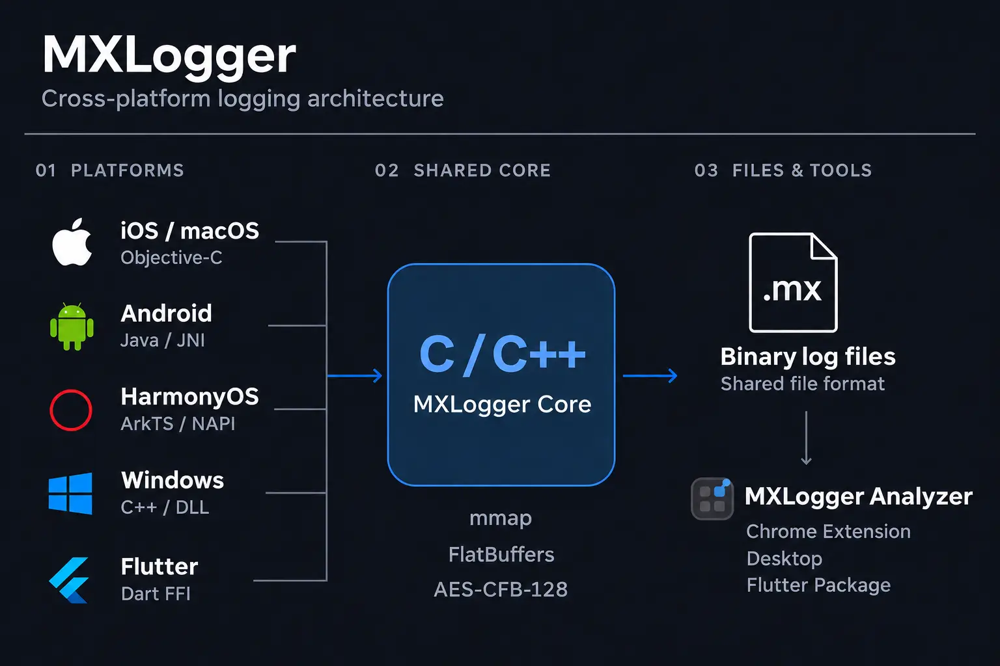
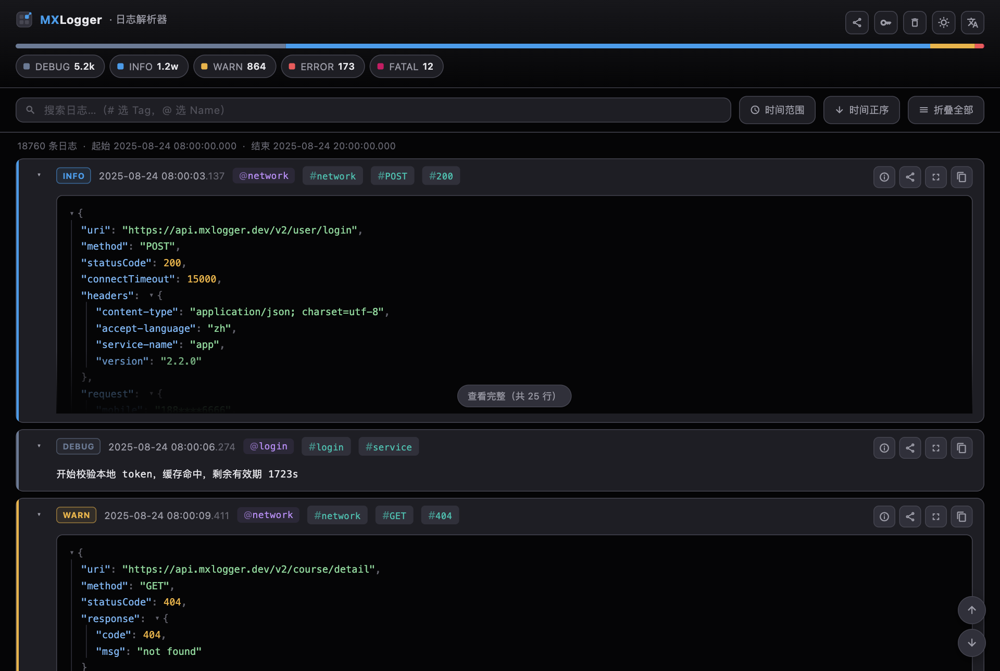
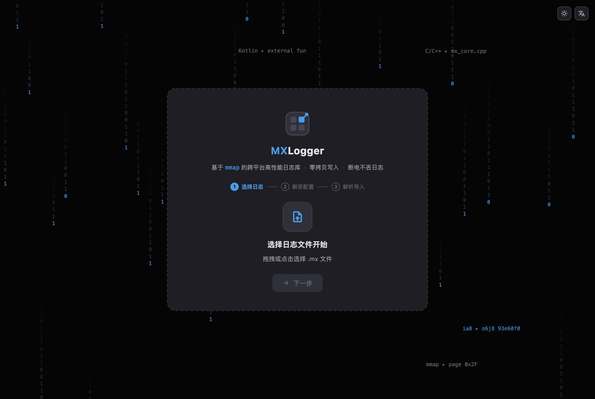
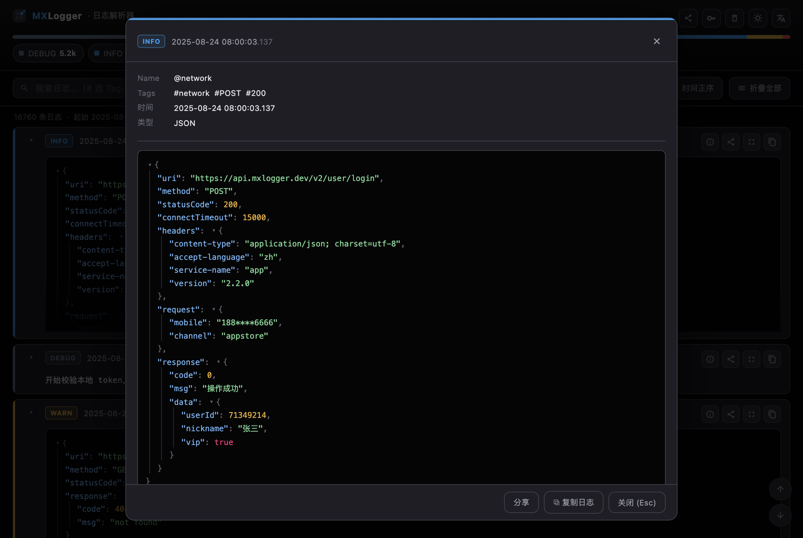
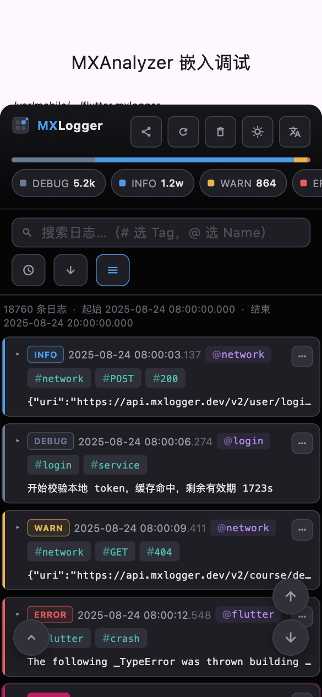
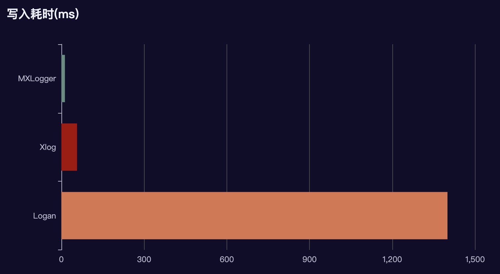

<p align="center">
  
  
  
  
  
</p>

<p align="center">
  
  <a href="https://chromewebstore.google.com/detail/mxlogger-analyzer/bpjhmakllccpeiglbfngmdbelimlghfi"></a>
  <a href="https://pub.dev/packages/mxlogger_analyzer_lib"></a>
</p>

<p align="center">
  <a href="https://github.com/coder-dongjiayi/MXLogger/blob/main/LICENSE.TXT"></a>
  <a href="https://cocoapods.org/pods/MXLogger"></a>
  <a href="https://central.sonatype.com/artifact/io.github.coder-dongjiayi/mxlogger"></a>
  <a href="https://pub.dev/packages/flutter_mxlogger"></a>
</p>

[English](./README.md) | [简体中文](./README_CN.md) | [日本語](./README_JA.md) | [한국어](./README_KO.md)

MXLogger は **mmap** によるメモリマッピングを利用するクロスプラットフォームのログライブラリです。**AES-CFB-128** 暗号化に対応し、iOS、macOS、Android、Windows、HarmonyOS のネイティブ SDK と Flutter プラグインを利用できます。コアは C/C++ で実装され、Google **FlatBuffers** でシリアライズします。Flutter からは `dart:ffi` で直接呼び出すため、ネイティブに近い性能を得られます。過去の iPhone 11 テストでは、約 134 バイトのログ 10 万件を約 **0.13 秒**で書き込みました。

付属の **mxlogger_analyzer** は、生成された `.mx` バイナリログの読み込み、復号、検索を行うツールです。Chrome 拡張機能、デスクトップアプリ（macOS / Windows / Linux）、iOS / Android の Flutter アプリに組み込むフローティングボタンとして利用できます。

- [ログ解析ツール](#log-analyzer)
- [インストール](#install)
- [クイックスタート](#quick-start)
- [API リファレンス](#api-reference)
  - [iOS / macOS](#ios-api) · [Android](#android-api) · [HarmonyOS](#harmonyos-api) · [Flutter](#flutter-api) · [解析ツール](#analyzer-api)
- [保存ポリシーとログレベル](#storage-policy-and-levels)
- [性能](#performance)
- [注意事項](#notes)

## 構成



MXLogger はログの**書き込み**と**解析**を提供します。ログをいつアップロードするかはアプリ側で決めます。公開されているログディレクトリ（`diskCachePath`）から自分のサーバーへファイルを送信し、ダウンロード後に mxlogger_analyzer で解析できます。

---

<a id="log-analyzer"></a>

# ログ解析ツール

`.mx` は AES-CFB-128 と FlatBuffers によるバイナリ形式のため、専用のリーダーが必要です。解析ツールはデータを SQLite に取り込み、全文検索、レベル・時刻・Tag・Name による絞り込み、JSON ツリー表示を提供します。

| 形式 | 概要 | 入手方法 |
| --- | --- | --- |
| Chrome 拡張機能 | Chrome で `.mx` ファイルを解析 | [Chrome ウェブストアからインストール](https://chromewebstore.google.com/detail/mxlogger-analyzer/bpjhmakllccpeiglbfngmdbelimlghfi) |
| デスクトップアプリ | macOS / Windows / Linux 向け。ファイルを選択またはドロップして解析 | [Releases](https://github.com/coder-dongjiayi/MXLogger/releases)（CI で 3 プラットフォームの配布物を生成） |
| アプリへの組み込み | iOS / Android の Flutter アプリ内にフローティングボタンとボトムシートを表示 | pub.dev の `mxlogger_analyzer_lib` |

HarmonyOS も同じ `.mx` 形式を使用します。ファイルをエクスポートし、同じ KEY/IV を指定して Chrome またはデスクトップの解析ツールで読み込めます。

Chrome でストアのリンクを開き、**Chrome に追加** → **拡張機能を追加**を選びます。拡張機能メニューから **MXLogger Analyzer** を開き、`.mx` ファイルを選択またはドロップしてください。暗号化されている場合は KEY / IV を設定して取り込みます。

**データ画面**：レベル分布バー、レベル別の絞り込み、検索、時刻フィルターを備えています。各ログカードには構文を色分けした JSON ツリーがあり、`@name` / `#tag` をクリックして絞り込めます。レコードごとに詳細表示、共有、全画面表示、コピーが可能です。右上の切り替えでライトテーマに変更できます。



**初回起動時の 3 ステップ**：① `.mx` ファイルを選択またはドロップ → ② 復号用 KEY / IV を設定（複数の組を登録でき、チェックボックスの番号順に試行）→ ③ 進捗を確認しながら取り込みます。



**レコードの全画面表示**（Esc で閉じる）：Name、Tags、時刻、レベル、完全な JSON ツリーを確認し、内容全体を共有またはコピーできます。



**ホストアプリへの組み込み**（スマートフォン）：画面の 85% を覆うボトムシートを表示します。余白を抑え、操作をアイコン化し、レベル選択を横スクロールにしています。カードは初期状態では折りたたまれ、操作は「⋯」メニューにまとめられます。

<p align="center">

</p>

解析ツールの詳細：[mxlogger_analyzer_lib/README.md](./mxlogger_analyzer/mxlogger_analyzer_lib/README.md)。

---

<a id="install"></a>

# インストール

## iOS / macOS

**CocoaPods** — `Podfile` に追加し、`pod install` を実行します。

```ruby
pod 'MXLogger', '~> 2.3.0'
```

**Swift Package Manager** — Xcode で **File → Add Package Dependencies…** を選び、次の URL を入力します。

```text
https://github.com/coder-dongjiayi/mxlogger-spm.git
```

**Up to Next Major Version** を選び、開始バージョンを **2.3.0** に設定して、**MXLogger** プロダクトをアプリのターゲットに追加します。

**Flutter ホストアプリ：FFI シンボルの保持** — iOS / macOS のホストアプリの **Runner** ターゲットで、
**Release** と **Profile** の **Build Settings → Strip Style** を **Non-Global Symbols** に設定するか、
両構成で使用する `.xcconfig` に次を追加してください。

```xcconfig
STRIP_STYLE = non-global
```

SwiftPM の静的リンクでは、`DynamicLibrary.process()` がアプリの実行ファイルから
`flutter_mxlogger_*` C 関数を検索します。**All Symbols** はアーカイブ時にこれらのグローバルシンボル名を
削除する可能性があり、Debug では動作しても、インストールしたリリースで
`Failed to lookup symbol 'flutter_mxlogger_initialize'` が発生することがあります。
インストールとホスト側の設定は [Flutter 導入ガイド](./platform/flutter_mxlogger/README_JA.md#ios--macos) を参照してください。

## Android

```groovy
implementation 'io.github.coder-dongjiayi:mxlogger:2.3.0'
```

## HarmonyOS (ArkTS)

利用するモジュール（例：`entry/`）のディレクトリで [OHPM 中心倉](https://ohpm.openharmony.cn/)からインストールします。

```sh
ohpm install @djy/mxlogger@2.3.1
```

HAR には ArkTS API と ARM64 / x86_64 ネイティブライブラリが含まれます。最小 API は 12、実機検証は API 26 / ARM64 で実施済みです。x86_64 はビルドのみ確認しています。ネイティブ ArkTS SDK は OHPM で公開済みです。Flutter HarmonyOS 開発版は現在のリポジトリに含まれ、pub.dev には未公開です。[Flutter ガイド](./platform/flutter_mxlogger/README_JA.md)を参照してください。[HarmonyOS SDK / Demo ガイド](./platform/OHOS/README.md)を参照してください。

## Windows

`MXLogger.Native.2.3.0.nupkg` をローカルフィードのフォルダー（例：`D:\NuGetFeed`）にダウンロードし、Visual Studio の Package Manager Console で実行します。

```powershell
Install-Package MXLogger.Native -Version 2.3.0 -Source D:\NuGetFeed
```

パッケージのダウンロードと vcpkg でのインストールは [Windows SDK ガイド](platform/Windows/README_JA.md)を参照してください。

## Flutter

```yaml
dependencies:
  flutter_mxlogger: ^2.3.0
  mxlogger_analyzer_lib: ^2.0.0   # 任意：アプリ内ログビューアー
```

`flutter pub get` を実行します。

---

<a id="quick-start"></a>

# クイックスタート

## iOS

```objective-c
MXLogger *logger = [MXLogger initializeWithNamespace:@"com.yourdomain.logger"
                                      storagePolicy:MXStoragePolicyYYYYMMDD
                                           fileName:@"mxlog"
                                         fileHeader:@"{\"app_version\":\"2.0.0\"}"
                                           cryptKey:@"abcuioqbsdguijlk"   // 16 bytes
                                                 iv:@"bccuioqbsdguijiv"];

logger.consoleEnable = YES;                 // debug only — set NO for benchmarks / release
logger.maxDiskAge   = 60 * 60 * 24 * 7;     // keep at most 7 days
logger.maxDiskSize  = 1024 * 1024 * 10;     // use at most 10 MB
logger.level        = 0;                    // 0:debug — write everything to file

[logger debugWithName:@"login" msg:@"token check started" tag:@"login,service"];
[logger infoWithName:@"network" msg:responseJSON tag:@"network,POST,200"];
[logger warnWithName:@"network" msg:@"retry #2" tag:@"network"];
[logger errorWithName:@"flutter" msg:stack tag:@"crash"];
[logger fatalWithName:@"database" msg:@"connection lost" tag:@"db,fatal"];

NSLog(@"logs live in %@", logger.diskCachePath);
```

## Android

```java
MXLogger logger = MXLogger.initialize(
        context,
        "com.yourdomain.logger",              // nameSpace
        null,                                 // diskCacheDirectory — null = default
        MXStoragePolicyType.YYYY_MM_DD,
        "mxlog",                              // fileName
        "{\"app_version\":\"2.0.0\"}",        // fileHeader
        "abcuioqbsdguijlk",                   // cryptKey, 16 bytes
        "bccuioqbsdguijiv");                  // iv

logger.setConsoleEnable(true);
logger.setMaxDiskAge(60 * 60 * 24 * 7);
logger.setMaxDiskSize(1024 * 1024 * 10);
logger.setLevel(0);

// Android takes tag first: debug(tag, name, msg)
logger.debug("login,service", "login", "token check started");
logger.info("network,POST,200", "network", responseJson);
logger.warn("network", "network", "retry #2");
logger.error("crash", "flutter", stack);
logger.fatal("db,fatal", "database", "connection lost");

Log.d("MXLogger", "logs live in " + logger.getDiskCachePath());
```

## HarmonyOS (ArkTS)

ArkUI コンポーネント内でホスト Context を取得して初期化します。

```typescript
import { MXLogger, MXLogLevel, MXStoragePolicy } from '@djy/mxlogger';

const context = this.getUIContext().getHostContext();
if (!context) { throw new Error('Context unavailable'); }
const logger = MXLogger.initialize(context, {
  nameSpace: 'com.yourdomain.logger',
  storagePolicy: MXStoragePolicy.Daily,
  fileName: 'mxlog',
  fileHeader: '{"app_version":"2.3.0"}',
  cryptKey: 'abcuioqbsdguijlk',
  iv: 'bccuioqbsdguijiv'
});
logger.setLevel(MXLogLevel.Debug);
logger.setMaxDiskAge(7 * 24 * 60 * 60);
logger.setMaxDiskSize(10 * 1024 * 1024);
logger.debug('token check started', { name: 'login', tag: 'login,service' });
logger.info('{"status":200}', { name: 'network', tag: 'network,POST' });
logger.warn('retry #2', { name: 'network', tag: 'network' });
logger.error('request failed', { name: 'network', tag: 'network' });
logger.fatal('connection lost', { name: 'database', tag: 'db,fatal' });
console.info(logger.diskCachePath);
```

既定の基本ディレクトリは `context.filesDir/com.mxlog.LoggerCache` で、Core が namespace を追加します。HiLog は既定で無効です。`setConsoleEnable(true)` で有効化できます。削除は `removeExpireData()` を明示的に呼び、共有セッションが不要になったら `destroy()` を呼びます。

## Flutter

```dart
final MXLogger logger = await MXLogger.initialize(
  nameSpace: "flutter.mxlogger",
  storagePolicy: MXStoragePolicyType.yyyyMMdd,
  fileHeader: jsonEncode(deviceInfo),
  consoleEnable: true,
  cryptKey: "abcuioqbsdguijlk",   // 16 bytes
  iv: "bccuioqbsdguijiv",         // defaults to cryptKey when omitted
);

logger.setMaxDiskAge(60 * 60 * 24 * 7);
logger.setMaxDiskSize(1024 * 1024 * 10);
logger.setLevel(0);

logger.debug("token check started", name: "login", tag: "login,service");
logger.info(jsonEncode(response), name: "network", tag: "network,POST,200");
logger.warn("retry #2", name: "network", tag: "network");
logger.error(stack, name: "flutter", tag: "crash");
logger.fatal("connection lost", name: "database", tag: "db,fatal");

debugPrint("logs live in ${logger.diskcachePath}");
```

---

<a id="api-reference"></a>

# API リファレンス

各プラットフォーム共通で、ロガーは **nameSpace + diskCacheDirectory** によって識別され、同じ組み合わせには同じ C++ インスタンスが使われます。その組み合わせの MD5 が **loggerToken** です。モジュール間でこの値を渡せば、ロガーオブジェクトを保持せずにクラスメソッドで書き込めます。

HarmonyOS は同一プロセスでのセッション共有に対応します。複数プロセスの同時書き込みは未検証です。初期化オプション `directory` は絶対パスの基本ディレクトリです。

ネイティブ macOS Core は、同じディレクトリを共有するプロセス間でアクセスを調整します。追記前にディレクトリ単位のファイルロックを取得し、確定済みの長さとマッピング容量を更新します。外部からの削除や置換を確認するためのパス検査は、毎回の追記では行いません。読み込みは共有ロック下で確定済みスナップショットをコピーし、解除後に復号・解析します。参加するすべてのプロセスで同じ方式、暗号化設定、アクセス可能な共有ディレクトリを使ってください。異なるディレクトリ間では待ち合わせません。iOS / Android のファイルアクセス方式は従来どおりで、Windows Core も `LockFileEx` で同じディレクトリを調整し、書き込みの間でマッピングを保持できます。ネイティブと Flutter Windows の両方を手動の `verify-logger` CI で検証します。Flutter はプリビルド DLL を読み込みます。

macOS / Windows Core の調整用ファイル `.mxlogger.lock` は、ログ一覧、容量計算、クリーンアップの対象外です。ロガーが動作している間は手動で削除しないでください。期間・容量による削除と `removeBeforeAllData` は、他のプロセスが使用中のファイルを保持します。`removeAllData` も使用中のファイルを保持し、未使用のログを削除します。`.mx` 形式は変更しておらず、CRC や電源断に対する耐久性保証を追加するものではありません。macOS / Windows Core では、ロック失敗または確定長が 32 ビット上限に達した場合に `-4` を返します。詳細は `errorDesc` で確認してください。

> **非推奨 API について。** `loggerToken` の旧称は `loggerKey` で、暗号化用の `cryptKey` と混同しやすい名前でした。iOS / Android / Flutter の各 `loggerKey` API は現在も対応する `loggerToken` API に転送されますが、非推奨であり、**将来のリリースで削除されます**。`loggerKey` → `loggerToken`、`xxxWithLoggerKey:` → `xxxWithLoggerToken:`、`getLoggerKey()` → `getLoggerToken()`、`logLoggerKey` → `logLoggerToken`、`destroyWithLoggerKey` → `destroyWithLoggerToken` に移行してください。

<a name="ios-api"></a>

## iOS / macOS — `MXLogger`（Objective-C）

### 生成と解放

| API | 説明 |
| --- | --- |
| `+ initializeWithNamespace:` | iOS の既定値：`Library/com.mxlog.LoggerCache`。macOS：`Application Support/<bundle-id>/MXLogger` |
| `+ initializeWithNamespace:fileHeader:` | ファイルヘッダーを指定 |
| `+ initializeWithNamespace:cryptKey:iv:fileHeader:` | 暗号化を有効化 |
| `+ initializeWithNamespace:storagePolicy:fileName:fileHeader:` | 保存ポリシーとファイル名を指定 |
| `+ initializeWithNamespace:storagePolicy:fileName:fileHeader:cryptKey:iv:` | 保存ポリシーと暗号化を指定 |
| `+ initializeWithNamespace:diskCacheDirectory:storagePolicy:fileName:fileHeader:cryptKey:iv:` | すべての引数を指定 |
| `- initWithNamespace:fileHeader:` | 同じ組み合わせのインスタンス初期化メソッド |
| `- initWithNamespace:diskCacheDirectory:fileHeader:` | |
| `- initWithNamespace:cryptKey:iv:fileHeader:` | |
| `- initWithNamespace:storagePolicy:fileName:fileHeader:` | |
| `- initWithNamespace:diskCacheDirectory:storagePolicy:fileName:fileHeader:cryptKey:iv:` | 指定イニシャライザー |
| `+ destroyWithNamespace:` | nameSpace を指定して解放（既定ディレクトリ） |
| `+ destroyWithNamespace:diskCacheDirectory:` | nameSpace とディレクトリを指定して解放 |
| `+ destroyWithLoggerToken:` | loggerToken を指定して解放 |
| `+ valueForLoggerToken:` | 既存のロガーを取得。存在しない場合は `nil` |
| `+ destroyWithLoggerKey:` / `+ valueForLoggerKey:` | **非推奨**。上記の `LoggerToken` 版に転送。将来のリリースで削除予定 |

### プロパティ

| プロパティ | 型 | 説明 |
| --- | --- | --- |
| `enable` | `BOOL` | ログ書き込みの全体スイッチ |
| `consoleEnable` | `BOOL` | コンソール出力。既定は無効。Release / Profile ではコンパイル時に除去（保持するには `MXLOGGER_CONSOLE_ENABLED=1` を定義） |
| `level` | `NSInteger` | ディスクに書き込む最小レベル。0 debug ～ 4 fatal |
| `maxDiskAge` | `NSUInteger` | 最大保存期間（秒）。0 は無制限 |
| `maxDiskSize` | `NSUInteger` | 最大合計サイズ（バイト）。0 は無制限 |
| `shouldRemoveExpiredDataWhenEnterBackground` | `BOOL` | iOS のバックグラウンド移行時に削除。既定は `YES`。macOS では無効 |
| `diskCachePath` | `NSString`（読み取り専用） | ログディレクトリ |
| `logSize` | `NSUInteger`（読み取り専用） | ディスク上のログサイズ（バイト） |
| `loggerToken` | `NSString`（読み取り専用） | nameSpace とディレクトリの MD5 |
| `loggerKey` | `NSString`（読み取り専用） | **非推奨**。`loggerToken` と同じ値。将来のリリースで削除予定 |

### 書き込み

| API | 説明 |
| --- | --- |
| `- logWithLevel:name:msg:tag:` | 成功は 0。失敗は -1（拡張）、-2（マッピング解除）、-3（mmap） |
| `- debugWithName:msg:tag:` | レベル 0 |
| `- infoWithName:msg:tag:` | レベル 1 |
| `- warnWithName:msg:tag:` | レベル 2 |
| `- errorWithName:msg:tag:` | レベル 3 |
| `- fatalWithName:msg:tag:` | レベル 4 |
| `+ debugWithLoggerToken:name:msg:tag:` | loggerToken 経由の書き込み。ロガーオブジェクトは不要 |
| `+ infoWithLoggerToken:name:msg:tag:` | |
| `+ warnWithLoggerToken:name:msg:tag:` | |
| `+ errorWithLoggerToken:name:msg:tag:` | |
| `+ fatalWithLoggerToken:name:msg:tag:` | |
| `+ xxxWithLoggerKey:name:msg:tag:` | **非推奨**。`xxxWithLoggerToken:` に転送。将来のリリースで削除予定 |

### ファイル、クリーンアップ、解析

| API | 説明 |
| --- | --- |
| `- logFiles` | 辞書の配列：`name` / `size` / `last_timestamp` / `create_timestamp` |
| `- errorDesc` | 直近の書き込みエラーの説明 |
| `- removeExpireData` | 期限切れファイルを削除し、`maxDiskSize` を超える場合は古いものから削除 |
| `- removeAllData` | 未使用のログを削除し、使用中のファイルを保持 |
| `- removeBeforeAllData` | 書き込み中のファイル以外をすべて削除 |
| `+ selectWithDiskCacheFilePath:cryptKey:iv:` | ファイルを解析して新しい順に返す：`name` / `msg` / `tag` / `level` / `timestamp` / `thread_id` / `is_main_thread` / `error_code` |

### `MXStoragePolicyType` (iOS / Objective-C)

`MXStoragePolicyYYYYMMDD`（日単位、既定）· `MXStoragePolicyYYYYMMDDHH`（時間単位）· `MXStoragePolicyYYYYWW`（週単位）· `MXStoragePolicyYYYYMM`（月単位）

<a name="android-api"></a>

## Android — `com.dongjiayi.mxlogger.MXLogger` (Java)

### 生成と解放

| API | 説明 |
| --- | --- |
| `MXLogger(Context, String nameSpace, String diskCacheDirectory, MXStoragePolicyType, String fileName, String fileHeader, String cryptKey, String iv)` | すべての引数を受け取るコンストラクター |
| `MXLogger(Context, String nameSpace, String fileHeader)` | 既定ディレクトリ |
| `MXLogger(Context, String nameSpace, String fileHeader, String cryptKey, String iv)` | 暗号化を有効化 |
| `MXLogger(Context, String fileHeader, String nameSpace, String diskCacheDirectory)` | ディレクトリを指定 |
| `static MXLogger initialize(Context, nameSpace, diskCacheDirectory, storagePolicy, fileName, fileHeader, cryptKey, iv)` | すべての引数を指定 |
| `static MXLogger initialize(Context, nameSpace, fileHeader)` | |
| `static MXLogger initialize(Context, nameSpace, fileHeader, cryptKey, iv)` | |
| `static void destroy(Context, String nameSpace, String diskCacheDirectory)` | nameSpace とディレクトリを指定して解放 |
| `static void destroy(String loggerToken)` | loggerToken を指定して解放 |

### 設定と状態

設定値は Java 側ではキャッシュしません。各 getter は常にネイティブの現在値を参照します。複数の Java ラッパーが 1 つのネイティブインスタンスを共有していても、同じ状態を取得できます。

| API | 説明 |
| --- | --- |
| `void setEnable(boolean)` / `boolean isEnable()` | ログ書き込みの全体スイッチ |
| `void setConsoleEnable(boolean)` / `boolean isConsoleEnable()` | コンソール出力 |
| `void setLevel(int)` / `int getLevel()` | ディスクに書き込む最小レベル。0 debug ～ 4 fatal |
| `void setMaxDiskAge(long)` / `long getMaxDiskAge()` | 最大保存期間（秒）。0 は無制限 |
| `void setMaxDiskSize(long)` / `long getMaxDiskSize()` | 最大合計サイズ（バイト）。0 は無制限 |
| `long getLogSize()` | ディスク上のログサイズ（バイト） |
| `String getDiskCachePath()` | ログディレクトリ |
| `String getLoggerToken()` | nameSpace とディレクトリの MD5 |
| `String getLoggerKey()` | **非推奨**。`getLoggerToken()` と同じ値。将来のリリースで削除予定 |
| `String getErrorDesc()` | 直近の書き込みエラーの説明 |

### 書き込み

Android の引数の順番に注意してください。**tag が最初**です。

| API | 説明 |
| --- | --- |
| `int debug(String tag, String name, String msg)` | レベル 0 |
| `int info(String tag, String name, String msg)` | レベル 1 |
| `int warn(String tag, String name, String msg)` | レベル 2 |
| `int error(String tag, String name, String msg)` | レベル 3 |
| `int fatal(String tag, String name, String msg)` | レベル 4 |
| `int log(String tag, int level, String name, String msg)` | 成功は 0、失敗は -1 / -2 / -3 |
| `static int log(String loggerToken, String tag, int level, String name, String msg)` | loggerToken 経由で書き込み |

### ファイル、クリーンアップ、解析

| API | 説明 |
| --- | --- |
| `String[] logFiles()` | ファイルごとに JSON 文字列を返す：`name` / `size` / `last_timestamp` / `create_timestamp` |
| `void removeExpireData()` | 期限切れファイルを削除し、`maxDiskSize` を超える場合は古いものから削除。Android にはライフサイクルの自動フックがないため、`onStop` などで明示的に呼び出す |
| `void removeAll()` | 未使用のログを削除し、使用中のファイルを保持 |
| `void removeBeforeAllData()` | 書き込み中のファイル以外をすべて削除 |
| `static String[] selectWithFilePath(String diskCacheFilePath, String cryptKey, String iv)` | ファイルを解析し、レコードごとに JSON 文字列を新しい順に返す |

### `MXStoragePolicyType` (Android / Java)

`YYYY_MM_DD`（日単位、既定）· `YYYY_MM_DD_HH`（時間単位）· `YYYY_WW`（週単位）· `YYYY_MM`（月単位）

Android Java では上記の大文字の列挙値を引き続き使用します。Flutter / Dart では `yyyyMMdd`、`yyyyMMddHH`、`yyyyWw`、`yyyyMM` を使用します。[Flutter API](#flutter-api) を参照してください。

<a name="harmonyos-api"></a>

## HarmonyOS — `@djy/mxlogger`（ArkTS）

| API | 説明 |
| --- | --- |
| `initialize(context, options) / initializeWithDirectory(directory, options)` | Context または絶対パスで初期化。namespace、保存ポリシー、ファイル名、ヘッダー、key、IV を指定可能 |
| `fromLoggerToken(token) / logWithToken(token, level, message, options?)` | 同一プロセスの共有セッションを取得、または token で書き込み |
| `debug/info/warn/error/fatal / log` | 5 レベルの簡易メソッドと任意レベル。options に `name`、`tag` を指定 |
| `setLevel / setEnable / setConsoleEnable` | 最小レベル、書き込みスイッチ、HiLog スイッチ |
| `setMaxDiskAge / setMaxDiskSize` | 保存期間は秒、サイズはバイト。`0` は無制限 |
| `state / isValid / loggerToken / diskCachePath / errorDesc / logSize` | ネイティブ状態、有効性、識別子、パス、エラー、ディスク使用量 |
| `level / enable / consoleEnable / maxDiskAge / maxDiskSize` | 現在の共有設定を取得 |
| `logFiles / readLogFile(filename)` | ファイル情報と、同じ key / IV で復号したレコード |
| `flush / removeExpireData / removeBeforeAllData / removeAll / destroy` | flush、削除、共有セッションの破棄。使用中のファイルは保持 |

`MXLogger.coreVersion()` は Core バージョンを返します。`MXStoragePolicy` は `Daily / Hourly / Weekly / Monthly`、`MXLogLevel` は Debug=0 ～ Fatal=4 です。再初期化では設定を維持してセッションを共有し、初期化設定が競合すると例外になります。`destroy()` はすべての別名を無効にし、GC はラッパーのみを解放します。[API とライフサイクルの詳細](./platform/OHOS/README.md#api)を参照してください。

<a name="flutter-api"></a>

## Flutter — `flutter_mxlogger`

読み書きはすべて `dart:ffi` を通じて行います。MethodChannel は `initialize` でプラットフォームの既定ディレクトリを取得するときだけ使用します。

### 生成と解放

| API | 説明 |
| --- | --- |
| `static Future<MXLogger> initialize({required String nameSpace, String? directory, bool consoleEnable = false, MXStoragePolicyType storagePolicy = MXStoragePolicyType.yyyyMMdd, String? fileName, String? fileHeader, String? cryptKey, String? iv})` | 推奨。プラットフォームの既定ディレクトリを解決（iOS：`Library/com.mxlog.LoggerCache/nameSpace`、Android：`files/com.mxlog.LoggerCache/nameSpace`） |
| `MXLogger({required String nameSpace, required String directory, ...})` | 同期コンストラクター。ディレクトリの明示指定が必要 |
| `static void destroy({required String nameSpace, String? directory})` | 解放前に対応する Dart インスタンスを無効化し、解放済みメモリへのアクセスを防ぐ |
| `static void destroyWithLoggerToken(String loggerToken)` | loggerToken を指定して解放 |
| `static void destroyWithLoggerKey(String loggerKey)` | **非推奨**。`destroyWithLoggerToken` に転送。将来のリリースで削除予定 |

### getter

| getter | 型 | 説明 |
| --- | --- | --- |
| `enable` | `bool` | 書き込みが有効かどうか |
| `consoleEnable` | `bool` | コンソール出力が有効かどうか |
| `diskcachePath` | `String` | ログディレクトリ（directory + nameSpace） |
| `diskcacheErrorPath` | `String` | ローカルエラーファイル `error.txt` のパス |
| `loggerToken` | `String?` | nameSpace とディレクトリの MD5 |
| `loggerKey` | `String?` | **非推奨**。`loggerToken` と同じ値。将来のリリースで削除予定 |
| `logSize` | `int` | ディスク上のログサイズ（バイト） |
| `logFiles` | `List<MXFileEntity>` | 保存されているログファイル |
| `errorDesc` | `String?` | 直近のネイティブ書き込みエラー。なければ `null` |
| `cryptKey` / `iv` | `String?` | 初期化時に指定した暗号化パラメーター。解析ツールにも同じ値を渡す |

### スイッチとディスク管理

| API | 説明 |
| --- | --- |
| `void setEnable(bool enable)` | ログ書き込みの全体スイッチ |
| `void setConsoleEnable(bool enable)` | コンソール出力。Release / Profile では tree shaking によって除去 |
| `void setLevel(int lvl)` | ディスクに書き込む最小レベル。0 debug ～ 4 fatal |
| `void setMaxDiskAge(int age)` | 最大保存期間（秒）。0 は無制限 |
| `void setMaxDiskSize(int size)` | 最大合計サイズ（バイト）。0 は無制限 |
| `void shouldRemoveExpiredDataWhenEnterBackground(bool should)` | モバイルでバックグラウンド移行時に自動削除。既定は `true`。macOS は明示的な呼び出しが必要 |
| `void removeExpireData()` | 期限切れファイルを削除し、容量上限を超える場合は古いものから削除 |
| `void removeAll()` | 未使用のログを削除し、使用中のファイルを保持 |
| `void removeBeforeAllData()` | 書き込み中のファイル以外をすべて削除 |
| `int getLogSize()` / `String getDiskcachePath()` / `String? getLoggerToken()` / `List<MXFileEntity> getLogFiles()` | 上記 getter のメソッド形式 |

### 書き込み

| API | 説明 |
| --- | --- |
| `int debug(String msg, {String? name, String? tag})` | レベル 0 |
| `int info(String msg, {String? name, String? tag})` | レベル 1 |
| `int warn(String msg, {String? name, String? tag})` | レベル 2 |
| `int error(String msg, {String? name, String? tag})` | レベル 3 |
| `int fatal(String msg, {String? name, String? tag})` | レベル 4 |
| `int log(int lvl, String msg, {String? name, String? tag})` | 成功は 0。失敗は -1（拡張）、-2（マッピング解除）、-3（mmap） |
| `static void logLoggerToken(String? loggerToken, int lvl, String msg, {String? name, String? tag})` | loggerToken 経由で書き込み |
| `static void logLoggerKey(...)` | **非推奨**。`logLoggerToken` に転送。将来のリリースで削除予定 |
| `static void debugLog(String? loggerToken, String msg, {String? name, String? tag})` | `infoLog` / `warnLog` / `errorLog` / `fatalLog` も同じ形式 |

### 書き込みエラーの記録と解析

| API | 説明 |
| --- | --- |
| `void writeFail({required int code, required String errorDesc, String? other})` | `log` が 0 以外を返したときに呼び出す。`diskcacheErrorPath` に JSON 行を追記 |
| `void deleteFailFile()` | ローカルエラーファイルを削除 |
| `void closeFailFile()` | エラーファイルの書き込みストリームを閉じる |
| `static List<Map<String, dynamic>> selectLogmsg({required String diskcacheFilePath, String? cryptKey, String? iv})` | ファイルを解析して新しい順に返す：`name` / `msg` / `tag` / `level` / `timestamp` / `thread_id` / `is_main_thread` / `error_code`。`error_code == "1"` は復号失敗（cryptKey または iv が不正） |
| `static List<Map<String, dynamic>> selectLogfiles({required String directory})` | **未実装**。すべてのプラットフォームで空のリストを返す。`logFiles` を使用 |

### `MXFileEntity`

`name`（`String?`）· `size`（`int`、バイト）· `createTimeStamp` / `lastTimeStamp`（`int`、秒）· `createTime` / `lastTime`（`DateTime`、タイムスタンプから算出）

### `MXStoragePolicyType` (Flutter / Dart)

`yyyyMMdd`（日単位、既定）· `yyyyMMddHH`（時間単位）· `yyyyWw`（週単位）· `yyyyMM`（月単位）

<a name="analyzer-api"></a>

## 解析ツール — `mxlogger_analyzer_lib`

### ホストアプリへの組み込み：`MXAnalyzer`

| API | 説明 |
| --- | --- |
| `static void initialize({String? databasePath, MXPrefs? prefs})` | 任意の事前設定。SQLite の保存先（既定は `getApplicationSupportDirectory()`）と、テーマ・言語・暗号化キーの組を保存する実装を指定。省略時はメモリ内のみ |
| `static Future<void> showDebug(OverlayState overlayState, {required String diskcachePath, required List<MxCryptPair> cryptPairs, required MXShareHandler onShare, String? databasePath})` | フローティングボタンを表示。ドラッグで移動、タップでシートを開き、ダブルタップで閉じる。表示中の再呼び出しは無視 |
| `static void dismiss()` | フローティングボタンを削除し、データベースを解放 |

```dart
final GlobalKey<NavigatorState> navigatorKey = GlobalKey<NavigatorState>();
// MaterialApp(navigatorKey: navigatorKey, ...)

await MXAnalyzer.showDebug(
  navigatorKey.currentState!.overlay!,
  diskcachePath: logger.diskcachePath,
  // Pass an empty list for plain logs; several pairs are tried in order,
  // per record — so a file whose writer rotated keys still comes out whole.
  cryptPairs: [
    MxCryptPair(key: logger.cryptKey ?? "", iv: logger.iv ?? ""),
    // MxCryptPair(key: "legacy-key", iv: "legacy-iv"),
  ],
  onShare: _shareWithSharePlus,   // return false to degrade to the clipboard
);

MXAnalyzer.dismiss();
```

シートを開くだけでは**解析しません**。ユーザーが「更新」を押すと `diskcachePath` 配下の `.mx` ファイルを走査します。更新のたびにデータベースをクリアし、最初から解析します。結果は SQLite に保存されるため、アプリを再起動しても前回のデータを表示できます。

### ホスト側の型

| 型 | 説明 |
| --- | --- |
| `MxCryptPair({required String key, String iv = ""})` | 復号キーの組。`iv` が空の場合はネイティブと同じく `key` を使用 |
| `MXShareHandler` = `Future<bool> Function(MXShareRequest)` | ホストが提供する共有処理。`false` を返すとクリップボードへのコピーに切り替える |
| `MXShareRequest` | `title` / `text` / `fileName`（null 以外ならテキストファイル共有）/ `origin`（呼び出し元の画面上の矩形。iPad / macOS のポップオーバーに必要） |
| `MXHost({required MXPrefs prefs, MXPickLogFiles? pickLogFiles, MXDropTargetBuilder? dropTargetBuilder, MXShareHandler? share})` | デスクトップ用機能の注入。未指定の機能はエラーにせず、対応する入口を非表示にする |
| `MXPrefs` / `MXMemoryPrefs` | 設定の永続化。既定はメモリ内の実装 |
| `MXStore` / `MXScope` / `MXState` / `MXAsyncState` | 独自の組み込み画面向けの、Stream を使った軽量な状態管理 |
| `MXLoggerAnalyzerApp` | 独自のデスクトップシェルに組み込める解析アプリ全体 |

---

<a id="storage-policy-and-levels"></a>

# 保存ポリシーとログレベル

**保存ポリシー**はファイルを切り替えるタイミングとファイル名を決定します。

| ポリシー | ファイル名 | |
| --- | --- | --- |
| 日単位（既定） | `2023-01-11_mxlog.mx` | 1 日につき 1 ファイル |
| 時間単位 | `2023-01-11-15_mxlog.mx` | 1 時間につき 1 ファイル |
| 週単位 | `2023-01-02w_mxlog.mx` | `02w` はその年の第 2 週 |
| 月単位 | `2023-01_mxlog.mx` | 1 か月につき 1 ファイル |

**ログレベル**は `0:debug 1:info 2:warn 3:error 4:fatal` です。レベルを *n* に設定すると、*n* 以上のログだけをファイルに保存します。例えば `level = 2` なら debug と info は除外され、warn / error / fatal を記録します。コンソールのフィルター動作はプラットフォームによって異なり、HarmonyOS の HiLog は `enable` とレベル設定の両方に従います。

**コンソール出力**は書き込み性能に影響するため、性能測定時は無効にしてください。利用可否はプラットフォームによって異なります。HarmonyOS の Release HAR は HiLog を保持し、既定では無効です。`setConsoleEnable(true)` で有効にします。

**暗号化**には AES-CFB-128 を使用します。[MMKV](https://github.com/Tencent/MMKV/tree/master/Core/aes) 由来の実装を利用しています。`cryptKey` と `iv` は 16 バイトで、長い場合は切り詰め、短い場合はゼロで埋めます。`iv` の省略時は `cryptKey` と同じ値になります。解析時に同じ組が必要なので、保存しておいてください。 HarmonyOS では現在、ポータブルな C の AES 実装を使用します。

**ファイルヘッダー**（`fileHeader`）はファイル作成時に 1 回だけ書き込まれます。アプリのバージョン、プラットフォーム、端末情報などの環境情報を入れる用途に適しています。解析ツールではスカラー値の一覧と JSON ツリーに展開して表示します。

---

<a id="performance"></a>

# 性能

現在の iOS / Android / macOS / Flutter / HarmonyOS Demo は、同じ 61 バイトのメッセージ（`[000001] This is a benchmark loooooooooooooooooooooooooooooog`）、`name=benchmark`、`tag=perf` で 100,000 件を記録します。Info / バックグラウンドスレッドではシリアライズ後 152 B、長さフィールドを含めて 156 B です。HarmonyOS の計測には Worker 起動と flush が含まれます。以下の過去の iOS 比較は、データと計測条件が異なります。

iOS での書き込み性能測定（デモは[こちら](./性能测试demo.zip)）：

- iPhone 11、iOS 14.6、Xcode Build Configuration = Release
- 1 件あたり約 134 バイト、10 万件をループで書き込み
- 10 回実行した平均値

| | MXLogger | Xlog | Logan |
| --- | --- | --- | --- |
| 所要時間 | **~0.13s** | ~0.57s | ~14.0s |
| ファイルサイズ | 14008320 B (14M) | 905753 B (0.9M) | 922452 B (0.9M) |



Logan と Xlog はデータを圧縮するため、ファイルサイズが小さくなります。MXLogger でも今後ログ圧縮への対応を予定しています。

---

<a id="notes"></a>

# 注意事項

- iOS の `Library/Caches` など、OS に削除される可能性のある場所をログディレクトリに**指定しないでください**。ディレクトリは起動時にだけ作成し、書き込みごとには作成しません。実行中に OS が削除すると、クラッシュや通知なしに記録されなくなる場合があります。
- **nameSpace + diskCacheDirectory** ごとにネイティブロガーは 1 つです。再初期化したラッパーも同じインスタンスを参照するため、設定変更はすべてに反映されます。
- nameSpace は逆ドメイン形式で指定し、重複を避けてください。
- モジュール化したアプリでは、サブモジュールに **loggerToken** を渡し、クラスメソッドで書き込めます。ロガーオブジェクトを渡す必要はありません。
- `maxDiskAge` / `maxDiskSize` は書き込みごとには適用されません。削除は `removeExpireData` で行います。iOS と Flutter モバイルではバックグラウンド移行時に自動実行し、ネイティブ Android、macOS、HarmonyOS では明示的な呼び出しが必要です。


<a id="license"></a>

# ライセンス

MXLogger は BSD 3-Clause ライセンスで公開されています。[LICENSE.TXT](./LICENSE.TXT) を参照してください。
