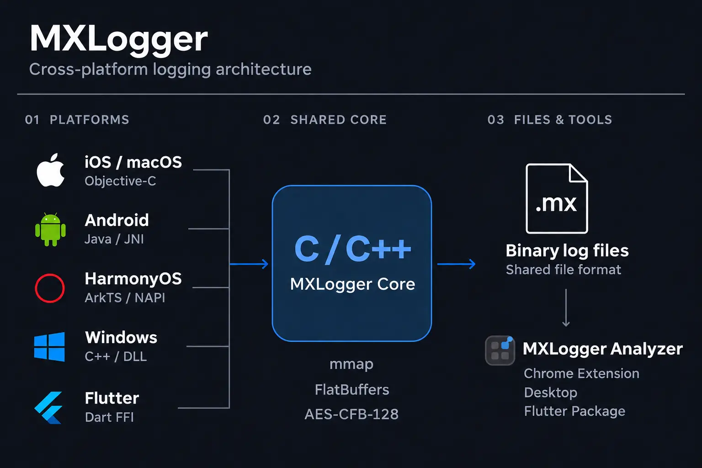
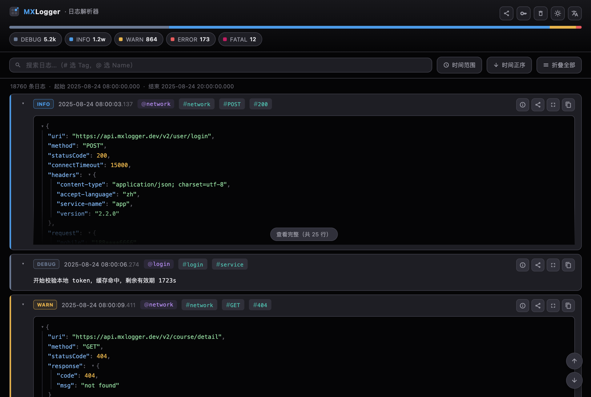
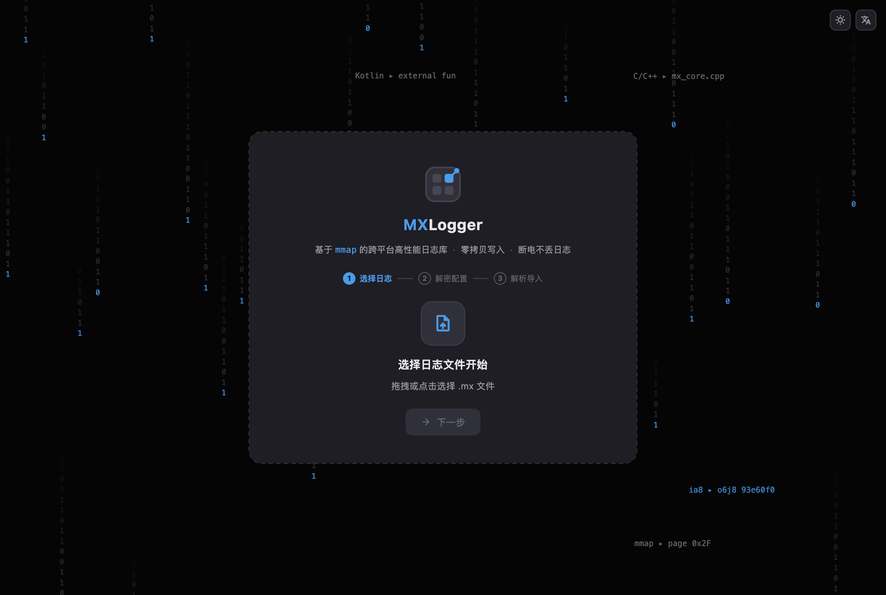
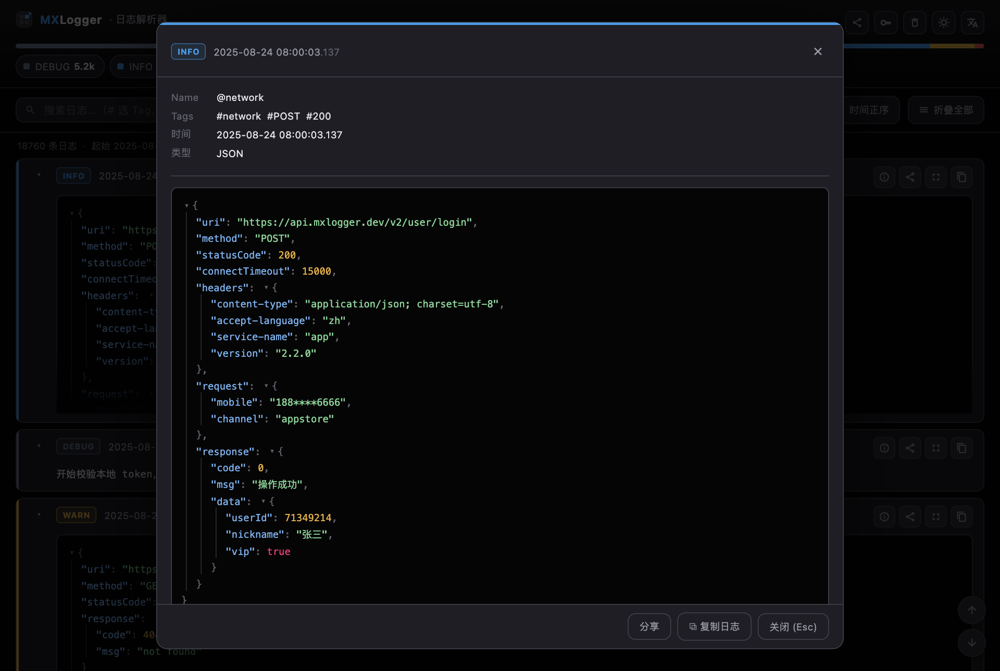
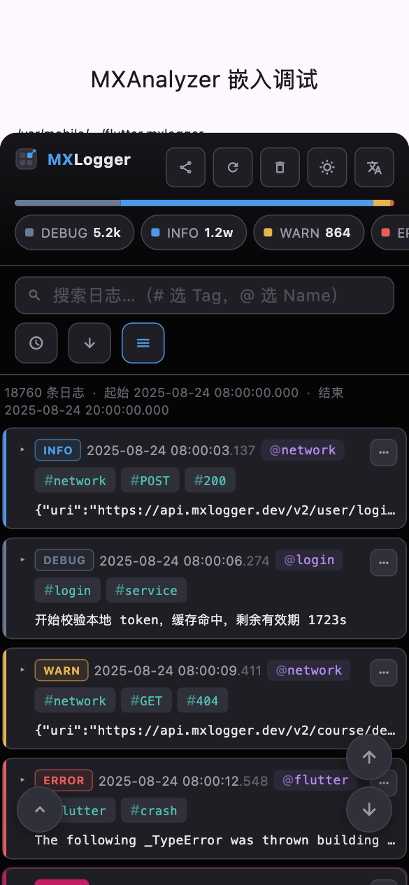
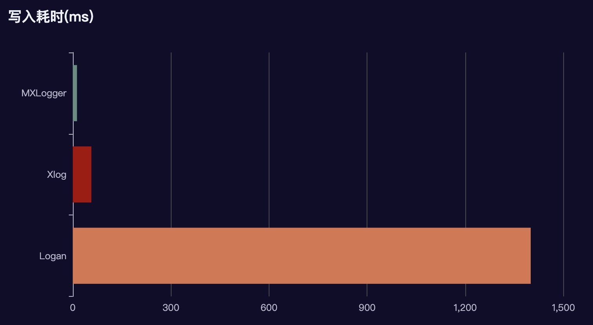

<p align="center">
  
  
  
  
</p>

<p align="center">
  
  <a href="https://chromewebstore.google.com/detail/mxlogger-analyzer/bpjhmakllccpeiglbfngmdbelimlghfi"></a>
  <a href="https://pub.dev/packages/mxlogger_analyzer_lib"></a>
</p>

<p align="center">
  <a href="https://github.com/coder-dongjiayi/MXLogger/blob/main/LICENSE.TXT"></a>
  <a href="https://cocoapods.org/pods/MXLogger"></a>
  <a href="https://central.sonatype.com/artifact/io.github.coder-dongjiayi/mxlogger"></a>
  <a href="https://pub.dev/packages/flutter_mxlogger"></a>
</p>

[English](./README.md) | [简体中文](./README_CN.md) | [日本語](./README_JA.md) | [한국어](./README_KO.md)

MXLogger는 **mmap** 메모리 매핑을 사용하는 크로스 플랫폼 로그 라이브러리로, **AES-CFB-128** 암호화와 iOS, macOS, Android, Flutter를 지원합니다. 코어는 C/C++로 구현되며 Google **FlatBuffers**로 직렬화합니다. Flutter에서는 `dart:ffi`로 직접 호출하므로 네이티브와 거의 같은 성능을 제공합니다. iPhone 11에서 레코드당 약 134바이트인 로그 10만 건을 기록하는 데 약 **0.13초**가 걸립니다.

함께 제공되는 **mxlogger_analyzer**는 생성된 `.mx` 바이너리 로그를 가져오고 복호화하며 검색하는 도구입니다. Chrome 확장 프로그램, 데스크톱 앱(macOS / Windows / Linux), iOS / Android Flutter 앱에 삽입하는 플로팅 버튼 형태로 사용할 수 있습니다.

- [로그 분석기](#log-analyzer)
- [설치](#install)
- [빠른 시작](#quick-start)
- [API 레퍼런스](#api-reference)
  - [iOS / macOS](#ios-api) · [Android](#android-api) · [Flutter](#flutter-api) · [분석기](#analyzer-api)
- [저장 정책과 로그 레벨](#storage-policy-and-levels)
- [성능](#performance)
- [주의 사항](#notes)

## 구조



MXLogger는 로그 **기록**과 **분석**을 제공합니다. 업로드 시점은 앱에서 결정합니다. 공개된 로그 디렉터리(`diskCachePath`)의 파일을 자체 서버로 전송한 뒤, 내려받아 mxlogger_analyzer로 분석할 수 있습니다.

---

<a id="log-analyzer"></a>

# 로그 분석기

`.mx`는 AES-CFB-128과 FlatBuffers를 사용하는 바이너리 형식이므로 전용 리더가 필요합니다. 분석기는 데이터를 SQLite로 가져와 전문 검색, 레벨·시간·Tag·Name 필터, JSON 트리 보기를 제공합니다.

| 형태 | 설명 | 이용 방법 |
| --- | --- | --- |
| Chrome 확장 프로그램 | Chrome에서 `.mx` 파일 분석 | [Chrome 웹 스토어에서 설치](https://chromewebstore.google.com/detail/mxlogger-analyzer/bpjhmakllccpeiglbfngmdbelimlghfi) |
| 데스크톱 앱 | macOS / Windows / Linux용 앱에서 파일을 선택하거나 끌어다 놓아 분석 | [Releases](https://github.com/coder-dongjiayi/MXLogger/releases)(CI에서 세 플랫폼의 배포 파일 생성) |
| 앱에 삽입 | iOS / Android Flutter 앱 안에 플로팅 버튼과 바텀 시트 표시 | pub.dev의 `mxlogger_analyzer_lib` |

Chrome에서 스토어 링크를 열고 **Chrome에 추가** → **확장 프로그램 추가**를 선택합니다. 확장 프로그램 메뉴에서 **MXLogger Analyzer**를 열어 `.mx` 파일을 선택하거나 끌어다 놓습니다. 암호화된 로그라면 KEY / IV를 설정한 다음 가져오기를 시작합니다.

**데이터 화면**: 레벨 분포 막대와 레벨 선택 칩, 검색 및 시간 필터를 제공합니다. 각 로그 카드에는 구문을 색으로 구분한 JSON 트리가 있으며, `@name` / `#tag`를 눌러 필터링할 수 있습니다. 레코드별 정보, 공유, 전체 화면, 복사 기능을 지원하며 오른쪽 위에서 밝은 테마로 전환할 수 있습니다.



**첫 실행 3단계 안내**: ① `.mx` 파일 선택 또는 끌어다 놓기 → ② 복호화 KEY / IV 설정(여러 쌍을 등록할 수 있으며 체크박스 번호순으로 시도) → ③ 실제 진행률을 보며 가져옵니다.



**레코드 전체 화면 보기**(Esc로 닫기): Name, Tags, 시간, 레벨과 전체 JSON 트리를 확인하고 내용을 통째로 공유하거나 복사할 수 있습니다.



**호스트 앱에 삽입**(휴대전화): 화면의 85%를 덮는 바텀 시트를 표시합니다. 여백을 줄이고 텍스트 대신 아이콘을 사용하며, 레벨 칩은 가로로 스크롤합니다. 카드는 기본적으로 접혀 있고 작업은 ‘⋯’ 메뉴에 모여 있습니다.

<p align="center">

</p>

분석기 상세 문서: [mxlogger_analyzer_lib/README.md](./mxlogger_analyzer/mxlogger_analyzer_lib/README.md).

---

<a id="install"></a>

# 설치

## iOS / macOS

**CocoaPods** — `Podfile`에 추가한 뒤 `pod install`을 실행합니다.

```ruby
pod 'MXLogger', '~> 2.3.0'
```

**Swift Package Manager** — Xcode에서 **File → Add Package Dependencies…**를 선택하고 다음 URL을 입력합니다.

```text
https://github.com/coder-dongjiayi/mxlogger-spm.git
```

**Up to Next Major Version**을 선택하고 시작 버전을 **2.3.0**으로 설정한 뒤, **MXLogger** 제품을 앱 타깃에 추가합니다.

## Android

```groovy
implementation 'io.github.coder-dongjiayi:mxlogger:2.3.0'
```

## Windows

`MXLogger.Native.2.3.0.nupkg`를 로컬 피드 폴더(예: `D:\NuGetFeed`)에 다운로드한 뒤 Visual Studio의 Package Manager Console에서 실행합니다.

```powershell
Install-Package MXLogger.Native -Version 2.3.0 -Source D:\NuGetFeed
```

패키지 다운로드 및 vcpkg 설치 방법은 [Windows SDK 가이드](platform/Windows/README_KO.md)를 참고하세요.

## Flutter

```yaml
dependencies:
  flutter_mxlogger: ^2.3.0
  mxlogger_analyzer_lib: ^2.0.0   # 선택 사항: 앱 내 로그 뷰어
```

`flutter pub get`을 실행합니다.

---

<a id="quick-start"></a>

# 빠른 시작

## iOS

```objective-c
MXLogger *logger = [MXLogger initializeWithNamespace:@"com.yourdomain.logger"
                                      storagePolicy:MXStoragePolicyYYYYMMDD
                                           fileName:@"mxlog"
                                         fileHeader:@"{\"app_version\":\"2.0.0\"}"
                                           cryptKey:@"abcuioqbsdguijlk"   // 16 bytes
                                                 iv:@"bccuioqbsdguijiv"];

logger.consoleEnable = YES;                 // debug only — set NO for benchmarks / release
logger.maxDiskAge   = 60 * 60 * 24 * 7;     // keep at most 7 days
logger.maxDiskSize  = 1024 * 1024 * 10;     // use at most 10 MB
logger.level        = 0;                    // 0:debug — write everything to file

[logger debugWithName:@"login" msg:@"token check started" tag:@"login,service"];
[logger infoWithName:@"network" msg:responseJSON tag:@"network,POST,200"];
[logger warnWithName:@"network" msg:@"retry #2" tag:@"network"];
[logger errorWithName:@"flutter" msg:stack tag:@"crash"];
[logger fatalWithName:@"database" msg:@"connection lost" tag:@"db,fatal"];

NSLog(@"logs live in %@", logger.diskCachePath);
```

## Android

```java
MXLogger logger = MXLogger.initialize(
        context,
        "com.yourdomain.logger",              // nameSpace
        null,                                 // diskCacheDirectory — null = default
        MXStoragePolicyType.YYYY_MM_DD,
        "mxlog",                              // fileName
        "{\"app_version\":\"2.0.0\"}",        // fileHeader
        "abcuioqbsdguijlk",                   // cryptKey, 16 bytes
        "bccuioqbsdguijiv");                  // iv

logger.setConsoleEnable(true);
logger.setMaxDiskAge(60 * 60 * 24 * 7);
logger.setMaxDiskSize(1024 * 1024 * 10);
logger.setLevel(0);

// Android takes tag first: debug(tag, name, msg)
logger.debug("login,service", "login", "token check started");
logger.info("network,POST,200", "network", responseJson);
logger.warn("network", "network", "retry #2");
logger.error("crash", "flutter", stack);
logger.fatal("db,fatal", "database", "connection lost");

Log.d("MXLogger", "logs live in " + logger.getDiskCachePath());
```

## Flutter

```dart
final MXLogger logger = await MXLogger.initialize(
  nameSpace: "flutter.mxlogger",
  storagePolicy: MXStoragePolicyType.yyyyMMdd,
  fileHeader: jsonEncode(deviceInfo),
  consoleEnable: true,
  cryptKey: "abcuioqbsdguijlk",   // 16 bytes
  iv: "bccuioqbsdguijiv",         // defaults to cryptKey when omitted
);

logger.setMaxDiskAge(60 * 60 * 24 * 7);
logger.setMaxDiskSize(1024 * 1024 * 10);
logger.setLevel(0);

logger.debug("token check started", name: "login", tag: "login,service");
logger.info(jsonEncode(response), name: "network", tag: "network,POST,200");
logger.warn("retry #2", name: "network", tag: "network");
logger.error(stack, name: "flutter", tag: "crash");
logger.fatal("connection lost", name: "database", tag: "db,fatal");

debugPrint("logs live in ${logger.diskcachePath}");
```

---

<a id="api-reference"></a>

# API 레퍼런스

모든 플랫폼에서 로거는 **nameSpace + diskCacheDirectory**로 식별되며, 같은 조합은 같은 C++ 인스턴스를 공유합니다. 이 조합의 MD5 값이 **loggerToken**입니다. 모듈 간에 이 값을 전달하면 로거 객체를 보관하지 않고 클래스 메서드로 기록할 수 있습니다.

네이티브 macOS Core는 같은 로그 디렉터리를 공유하는 프로세스의 접근을 조정합니다. 추가 기록 전에 디렉터리 단위 파일 잠금을 획득하고 확정된 길이와 매핑 용량을 갱신합니다. 외부 삭제나 교체 여부를 확인하는 경로 검사를 매번 수행하지 않습니다. 읽을 때는 공유 잠금 아래에서 확정된 스냅샷을 복사한 뒤 잠금을 풀고 복호화·분석합니다. 참여하는 모든 프로세스는 같은 방식과 암호화 설정, 접근 가능한 공유 디렉터리를 사용해야 합니다. 서로 다른 디렉터리는 서로를 기다리지 않습니다. iOS / Android의 기존 파일 접근 방식은 유지되며, Windows Core도 `LockFileEx`로 같은 디렉터리의 접근을 조정하며 기록 사이에 매핑을 유지할 수 있습니다. 네이티브 및 Flutter Windows 통합을 수동 `verify-logger` CI에서 검증합니다. Flutter는 사전 빌드 DLL을 불러옵니다.

macOS / Windows Core의 조정 파일 `.mxlogger.lock`은 로그 목록, 용량 계산과 정리 대상에서 제외됩니다. 로거가 살아 있는 동안 수동으로 삭제하지 마세요. 보관 기간·용량 기반 정리와 `removeBeforeAllData`는 다른 프로세스가 사용 중인 파일을 보존합니다. `removeAllData`도 사용 중인 파일을 보존하며 사용하지 않는 로그를 삭제합니다. `.mx` 형식은 바뀌지 않았고, CRC나 전원 차단 내구성 보장이 추가되는 것은 아닙니다. macOS / Windows Core에서는 잠금 실패 또는 확정 길이가 32비트 한도에 도달하면 `-4`를 반환할 수 있습니다. 자세한 내용은 `errorDesc`를 확인하세요.

> **사용 중단 예정 API 안내.** `loggerToken`의 이전 이름은 `loggerKey`였으며, 암호화용 `cryptKey`와 혼동하기 쉬웠습니다. iOS / Android / Flutter의 각 `loggerKey` API는 현재도 대응하는 `loggerToken` API로 전달되지만 사용 중단 예정이며 **향후 릴리스에서 제거됩니다**. `loggerKey` → `loggerToken`, `xxxWithLoggerKey:` → `xxxWithLoggerToken:`, `getLoggerKey()` → `getLoggerToken()`, `logLoggerKey` → `logLoggerToken`, `destroyWithLoggerKey` → `destroyWithLoggerToken`으로 이전하세요.

<a name="ios-api"></a>

## iOS / macOS — `MXLogger`(Objective-C)

### 생성과 해제

| API | 설명 |
| --- | --- |
| `+ initializeWithNamespace:` | iOS 기본값: `Library/com.mxlog.LoggerCache`. macOS: `Application Support/<bundle-id>/MXLogger` |
| `+ initializeWithNamespace:fileHeader:` | 파일 헤더 지정 |
| `+ initializeWithNamespace:cryptKey:iv:fileHeader:` | 암호화 사용 |
| `+ initializeWithNamespace:storagePolicy:fileName:fileHeader:` | 저장 정책과 파일 이름 지정 |
| `+ initializeWithNamespace:storagePolicy:fileName:fileHeader:cryptKey:iv:` | 저장 정책과 암호화 지정 |
| `+ initializeWithNamespace:diskCacheDirectory:storagePolicy:fileName:fileHeader:cryptKey:iv:` | 전체 매개변수 지정 |
| `- initWithNamespace:fileHeader:` | 같은 조합의 인스턴스 초기화 메서드 |
| `- initWithNamespace:diskCacheDirectory:fileHeader:` | |
| `- initWithNamespace:cryptKey:iv:fileHeader:` | |
| `- initWithNamespace:storagePolicy:fileName:fileHeader:` | |
| `- initWithNamespace:diskCacheDirectory:storagePolicy:fileName:fileHeader:cryptKey:iv:` | 지정 초기화 메서드 |
| `+ destroyWithNamespace:` | nameSpace로 해제(기본 디렉터리) |
| `+ destroyWithNamespace:diskCacheDirectory:` | nameSpace와 디렉터리로 해제 |
| `+ destroyWithLoggerToken:` | loggerToken으로 해제 |
| `+ valueForLoggerToken:` | 기존 로거 반환. 없으면 `nil` |
| `+ destroyWithLoggerKey:` / `+ valueForLoggerKey:` | **사용 중단 예정**. 위의 `LoggerToken` 버전으로 전달하며 향후 릴리스에서 제거 예정 |

### 속성

| 속성 | 타입 | 설명 |
| --- | --- | --- |
| `enable` | `BOOL` | 로그 기록 전체 스위치 |
| `consoleEnable` | `BOOL` | 콘솔 출력. 기본값은 비활성화. Release / Profile에서는 컴파일 시 제거(`MXLOGGER_CONSOLE_ENABLED=1`을 정의하면 유지) |
| `level` | `NSInteger` | 디스크에 기록할 최소 레벨. 0 debug ~ 4 fatal |
| `maxDiskAge` | `NSUInteger` | 최대 보관 기간(초). 0은 무제한 |
| `maxDiskSize` | `NSUInteger` | 최대 전체 크기(바이트). 0은 무제한 |
| `shouldRemoveExpiredDataWhenEnterBackground` | `BOOL` | iOS 백그라운드 전환 시 정리. 기본값은 `YES`. macOS에서는 동작하지 않음 |
| `diskCachePath` | `NSString`(읽기 전용) | 로그 디렉터리 |
| `logSize` | `NSUInteger`(읽기 전용) | 디스크에 저장된 로그 크기(바이트) |
| `loggerToken` | `NSString`(읽기 전용) | nameSpace와 디렉터리의 MD5 |
| `loggerKey` | `NSString`(읽기 전용) | **사용 중단 예정**. `loggerToken`과 같은 값이며 향후 릴리스에서 제거 예정 |

### 기록

| API | 설명 |
| --- | --- |
| `- logWithLevel:name:msg:tag:` | 성공 시 0. 실패 시 -1(확장), -2(매핑 해제), -3(mmap) |
| `- debugWithName:msg:tag:` | 레벨 0 |
| `- infoWithName:msg:tag:` | 레벨 1 |
| `- warnWithName:msg:tag:` | 레벨 2 |
| `- errorWithName:msg:tag:` | 레벨 3 |
| `- fatalWithName:msg:tag:` | 레벨 4 |
| `+ debugWithLoggerToken:name:msg:tag:` | loggerToken으로 기록. 로거 객체 불필요 |
| `+ infoWithLoggerToken:name:msg:tag:` | |
| `+ warnWithLoggerToken:name:msg:tag:` | |
| `+ errorWithLoggerToken:name:msg:tag:` | |
| `+ fatalWithLoggerToken:name:msg:tag:` | |
| `+ xxxWithLoggerKey:name:msg:tag:` | **사용 중단 예정**. `xxxWithLoggerToken:`으로 전달하며 향후 릴리스에서 제거 예정 |

### 파일, 정리 및 분석

| API | 설명 |
| --- | --- |
| `- logFiles` | 딕셔너리 배열: `name` / `size` / `last_timestamp` / `create_timestamp` |
| `- errorDesc` | 최근 기록 오류 설명 |
| `- removeExpireData` | 기간이 지난 파일을 지운 뒤 `maxDiskSize`를 초과하면 오래된 파일부터 삭제 |
| `- removeAllData` | 사용하지 않는 로그를 삭제하고 사용 중인 파일은 보존 |
| `- removeBeforeAllData` | 현재 기록 중인 파일을 제외한 모든 파일 삭제 |
| `+ selectWithDiskCacheFilePath:cryptKey:iv:` | 파일을 분석해 최신순으로 반환: `name` / `msg` / `tag` / `level` / `timestamp` / `thread_id` / `is_main_thread` / `error_code` |

### `MXStoragePolicyType` (iOS / Objective-C)

`MXStoragePolicyYYYYMMDD`(일별, 기본값) · `MXStoragePolicyYYYYMMDDHH`(시간별) · `MXStoragePolicyYYYYWW`(주별) · `MXStoragePolicyYYYYMM`(월별)

<a name="android-api"></a>

## Android — `com.dongjiayi.mxlogger.MXLogger` (Java)

### 생성과 해제

| API | 설명 |
| --- | --- |
| `MXLogger(Context, String nameSpace, String diskCacheDirectory, MXStoragePolicyType, String fileName, String fileHeader, String cryptKey, String iv)` | 전체 매개변수를 받는 생성자 |
| `MXLogger(Context, String nameSpace, String fileHeader)` | 기본 디렉터리 |
| `MXLogger(Context, String nameSpace, String fileHeader, String cryptKey, String iv)` | 암호화 사용 |
| `MXLogger(Context, String fileHeader, String nameSpace, String diskCacheDirectory)` | 사용자 지정 디렉터리 |
| `static MXLogger initialize(Context, nameSpace, diskCacheDirectory, storagePolicy, fileName, fileHeader, cryptKey, iv)` | 전체 매개변수 지정 |
| `static MXLogger initialize(Context, nameSpace, fileHeader)` | |
| `static MXLogger initialize(Context, nameSpace, fileHeader, cryptKey, iv)` | |
| `static void destroy(Context, String nameSpace, String diskCacheDirectory)` | nameSpace와 디렉터리로 해제 |
| `static void destroy(String loggerToken)` | loggerToken으로 해제 |

### 설정과 상태

설정은 Java 쪽에서 캐시하지 않습니다. 각 getter는 항상 네이티브의 현재 값을 조회합니다. 여러 Java 래퍼가 하나의 네이티브 인스턴스를 공유해도 같은 상태를 확인할 수 있습니다.

| API | 설명 |
| --- | --- |
| `void setEnable(boolean)` / `boolean isEnable()` | 로그 기록 전체 스위치 |
| `void setConsoleEnable(boolean)` / `boolean isConsoleEnable()` | 콘솔 출력 |
| `void setLevel(int)` / `int getLevel()` | 디스크에 기록할 최소 레벨. 0 debug ~ 4 fatal |
| `void setMaxDiskAge(long)` / `long getMaxDiskAge()` | 최대 보관 기간(초). 0은 무제한 |
| `void setMaxDiskSize(long)` / `long getMaxDiskSize()` | 최대 전체 크기(바이트). 0은 무제한 |
| `long getLogSize()` | 디스크에 저장된 로그 크기(바이트) |
| `String getDiskCachePath()` | 로그 디렉터리 |
| `String getLoggerToken()` | nameSpace와 디렉터리의 MD5 |
| `String getLoggerKey()` | **사용 중단 예정**. `getLoggerToken()`과 같은 값이며 향후 릴리스에서 제거 예정 |
| `String getErrorDesc()` | 최근 기록 오류 설명 |

### 기록

Android의 매개변수 순서에 주의하세요. **tag가 첫 번째**입니다.

| API | 설명 |
| --- | --- |
| `int debug(String tag, String name, String msg)` | 레벨 0 |
| `int info(String tag, String name, String msg)` | 레벨 1 |
| `int warn(String tag, String name, String msg)` | 레벨 2 |
| `int error(String tag, String name, String msg)` | 레벨 3 |
| `int fatal(String tag, String name, String msg)` | 레벨 4 |
| `int log(String tag, int level, String name, String msg)` | 성공 시 0, 실패 시 -1 / -2 / -3 |
| `static int log(String loggerToken, String tag, int level, String name, String msg)` | loggerToken으로 기록 |

### 파일, 정리 및 분석

| API | 설명 |
| --- | --- |
| `String[] logFiles()` | 파일마다 JSON 문자열 반환: `name` / `size` / `last_timestamp` / `create_timestamp` |
| `void removeExpireData()` | 기간이 지난 파일을 지운 뒤 `maxDiskSize`를 초과하면 오래된 파일부터 삭제. Android에는 자동 수명 주기 훅이 없으므로 `onStop` 등에서 직접 호출 |
| `void removeAll()` | 사용하지 않는 로그를 삭제하고 사용 중인 파일은 보존 |
| `void removeBeforeAllData()` | 현재 기록 중인 파일을 제외한 모든 파일 삭제 |
| `static String[] selectWithFilePath(String diskCacheFilePath, String cryptKey, String iv)` | 파일을 분석하고 레코드마다 JSON 문자열을 최신순으로 반환 |

### `MXStoragePolicyType` (Android / Java)

`YYYY_MM_DD`(일별, 기본값) · `YYYY_MM_DD_HH`(시간별) · `YYYY_WW`(주별) · `YYYY_MM`(월별)

Android Java에서는 위의 대문자 열거형 값을 계속 사용합니다. Flutter / Dart는 `yyyyMMdd`, `yyyyMMddHH`, `yyyyWw`, `yyyyMM`을 사용합니다. [Flutter API](#flutter-api)를 참고하세요.

<a name="flutter-api"></a>

## Flutter — `flutter_mxlogger`

읽기와 쓰기는 모두 `dart:ffi`를 사용합니다. MethodChannel은 `initialize`에서 플랫폼의 기본 디렉터리를 가져올 때만 사용합니다.

### 생성과 해제

| API | 설명 |
| --- | --- |
| `static Future<MXLogger> initialize({required String nameSpace, String? directory, bool consoleEnable = false, MXStoragePolicyType storagePolicy = MXStoragePolicyType.yyyyMMdd, String? fileName, String? fileHeader, String? cryptKey, String? iv})` | 권장. 플랫폼 기본 디렉터리 해석(iOS: `Library/com.mxlog.LoggerCache/nameSpace`, Android: `files/com.mxlog.LoggerCache/nameSpace`) |
| `MXLogger({required String nameSpace, required String directory, ...})` | 동기 생성자. 디렉터리를 명시해야 함 |
| `static void destroy({required String nameSpace, String? directory})` | 해제 전에 대응하는 Dart 인스턴스를 무효화해 해제된 메모리 접근을 방지 |
| `static void destroyWithLoggerToken(String loggerToken)` | loggerToken으로 해제 |
| `static void destroyWithLoggerKey(String loggerKey)` | **사용 중단 예정**. `destroyWithLoggerToken`으로 전달하며 향후 릴리스에서 제거 예정 |

### getter

| getter | 타입 | 설명 |
| --- | --- | --- |
| `enable` | `bool` | 기록 활성화 여부 |
| `consoleEnable` | `bool` | 콘솔 출력 활성화 여부 |
| `diskcachePath` | `String` | 로그 디렉터리(directory + nameSpace) |
| `diskcacheErrorPath` | `String` | 로컬 오류 파일 `error.txt`의 경로 |
| `loggerToken` | `String?` | nameSpace와 디렉터리의 MD5 |
| `loggerKey` | `String?` | **사용 중단 예정**. `loggerToken`과 같은 값이며 향후 릴리스에서 제거 예정 |
| `logSize` | `int` | 디스크에 저장된 로그 크기(바이트) |
| `logFiles` | `List<MXFileEntity>` | 저장된 로그 파일 |
| `errorDesc` | `String?` | 최근 네이티브 기록 오류. 없으면 `null` |
| `cryptKey` / `iv` | `String?` | 초기화 시 지정한 암호화 매개변수. 분석기에도 같은 값을 전달 |

### 스위치와 디스크 관리

| API | 설명 |
| --- | --- |
| `void setEnable(bool enable)` | 로그 기록 전체 스위치 |
| `void setConsoleEnable(bool enable)` | 콘솔 출력. Release / Profile에서는 트리 셰이킹으로 제거 |
| `void setLevel(int lvl)` | 디스크에 기록할 최소 레벨. 0 debug ~ 4 fatal |
| `void setMaxDiskAge(int age)` | 최대 보관 기간(초). 0은 무제한 |
| `void setMaxDiskSize(int size)` | 최대 전체 크기(바이트). 0은 무제한 |
| `void shouldRemoveExpiredDataWhenEnterBackground(bool should)` | 모바일에서 백그라운드 전환 시 자동 정리. 기본값은 `true`. macOS에서는 직접 호출해야 함 |
| `void removeExpireData()` | 기간이 지난 파일을 지운 뒤 용량 한도를 초과하면 오래된 파일부터 삭제 |
| `void removeAll()` | 사용하지 않는 로그를 삭제하고 사용 중인 파일은 보존 |
| `void removeBeforeAllData()` | 현재 기록 중인 파일을 제외한 모든 파일 삭제 |
| `int getLogSize()` / `String getDiskcachePath()` / `String? getLoggerToken()` / `List<MXFileEntity> getLogFiles()` | 위 getter의 메서드 형태 |

### 기록

| API | 설명 |
| --- | --- |
| `int debug(String msg, {String? name, String? tag})` | 레벨 0 |
| `int info(String msg, {String? name, String? tag})` | 레벨 1 |
| `int warn(String msg, {String? name, String? tag})` | 레벨 2 |
| `int error(String msg, {String? name, String? tag})` | 레벨 3 |
| `int fatal(String msg, {String? name, String? tag})` | 레벨 4 |
| `int log(int lvl, String msg, {String? name, String? tag})` | 성공 시 0. 실패 시 -1(확장), -2(매핑 해제), -3(mmap) |
| `static void logLoggerToken(String? loggerToken, int lvl, String msg, {String? name, String? tag})` | loggerToken으로 기록 |
| `static void logLoggerKey(...)` | **사용 중단 예정**. `logLoggerToken`으로 전달하며 향후 릴리스에서 제거 예정 |
| `static void debugLog(String? loggerToken, String msg, {String? name, String? tag})` | `infoLog` / `warnLog` / `errorLog` / `fatalLog`도 같은 형태 |

### 기록 오류 저장과 분석

| API | 설명 |
| --- | --- |
| `void writeFail({required int code, required String errorDesc, String? other})` | `log`가 0이 아닌 값을 반환할 때 호출. `diskcacheErrorPath`에 JSON 한 줄 추가 |
| `void deleteFailFile()` | 로컬 오류 파일 삭제 |
| `void closeFailFile()` | 오류 파일 쓰기 스트림 닫기 |
| `static List<Map<String, dynamic>> selectLogmsg({required String diskcacheFilePath, String? cryptKey, String? iv})` | 파일을 분석해 최신순으로 반환: `name` / `msg` / `tag` / `level` / `timestamp` / `thread_id` / `is_main_thread` / `error_code`. `error_code == "1"`은 복호화 실패(잘못된 cryptKey 또는 iv) |
| `static List<Map<String, dynamic>> selectLogfiles({required String directory})` | **미구현**. 모든 플랫폼에서 빈 목록을 반환하므로 `logFiles` 사용 |

### `MXFileEntity`

`name`(`String?`) · `size`(`int`, 바이트) · `createTimeStamp` / `lastTimeStamp`(`int`, 초) · `createTime` / `lastTime`(`DateTime`, 타임스탬프에서 계산)

### `MXStoragePolicyType` (Flutter / Dart)

`yyyyMMdd`(일별, 기본값) · `yyyyMMddHH`(시간별) · `yyyyWw`(주별) · `yyyyMM`(월별)

<a name="analyzer-api"></a>

## 분석기 — `mxlogger_analyzer_lib`

### 호스트 앱에 삽입: `MXAnalyzer`

| API | 설명 |
| --- | --- |
| `static void initialize({String? databasePath, MXPrefs? prefs})` | 선택적 사전 설정. SQLite 디렉터리(기본값은 `getApplicationSupportDirectory()`)와 테마·언어·암호화 키 쌍의 저장 구현 지정. 생략 시 메모리에만 저장 |
| `static Future<void> showDebug(OverlayState overlayState, {required String diskcachePath, required List<MxCryptPair> cryptPairs, required MXShareHandler onShare, String? databasePath})` | 플로팅 버튼 표시. 드래그로 이동, 탭으로 시트 열기, 두 번 탭으로 닫기. 이미 표시 중이면 다시 호출해도 무시 |
| `static void dismiss()` | 플로팅 버튼을 제거하고 데이터베이스 해제 |

```dart
final GlobalKey<NavigatorState> navigatorKey = GlobalKey<NavigatorState>();
// MaterialApp(navigatorKey: navigatorKey, ...)

await MXAnalyzer.showDebug(
  navigatorKey.currentState!.overlay!,
  diskcachePath: logger.diskcachePath,
  // Pass an empty list for plain logs; several pairs are tried in order,
  // per record — so a file whose writer rotated keys still comes out whole.
  cryptPairs: [
    MxCryptPair(key: logger.cryptKey ?? "", iv: logger.iv ?? ""),
    // MxCryptPair(key: "legacy-key", iv: "legacy-iv"),
  ],
  onShare: _shareWithSharePlus,   // return false to degrade to the clipboard
);

MXAnalyzer.dismiss();
```

시트를 열기만 해서는 **분석하지 않습니다**. 사용자가 ‘새로 고침’을 누르면 `diskcachePath` 아래의 `.mx` 파일을 검색합니다. 새로 고칠 때마다 데이터베이스를 비우고 처음부터 다시 분석합니다. 결과는 SQLite에 저장되므로 앱을 다시 시작해도 이전 데이터를 볼 수 있습니다.

### 호스트 타입

| 타입 | 설명 |
| --- | --- |
| `MxCryptPair({required String key, String iv = ""})` | 복호화 키 쌍. `iv`가 비어 있으면 네이티브와 동일하게 `key` 사용 |
| `MXShareHandler` = `Future<bool> Function(MXShareRequest)` | 호스트가 제공하는 공유 처리. `false`를 반환하면 클립보드 복사로 대체 |
| `MXShareRequest` | `title` / `text` / `fileName`(null이 아니면 텍스트 파일 공유) / `origin`(호출한 요소의 화면상 사각형. iPad / macOS 팝오버에 필요) |
| `MXHost({required MXPrefs prefs, MXPickLogFiles? pickLogFiles, MXDropTargetBuilder? dropTargetBuilder, MXShareHandler? share})` | 데스크톱 기능 주입. 지정하지 않은 기능은 오류 대신 해당 진입점을 숨김 |
| `MXPrefs` / `MXMemoryPrefs` | 설정 영구 저장. 기본값은 메모리 구현 |
| `MXStore` / `MXScope` / `MXState` / `MXAsyncState` | 사용자 지정 삽입 화면용 Stream 기반 경량 상태 관리 |
| `MXLoggerAnalyzerApp` | 사용자 지정 데스크톱 셸에 삽입할 수 있는 전체 분석 앱 |

---

<a id="storage-policy-and-levels"></a>

# 저장 정책과 로그 레벨

**저장 정책**은 파일을 분할하는 시점과 파일 이름을 결정합니다.

| 정책 | 파일 이름 | |
| --- | --- | --- |
| 일별(기본값) | `2023-01-11_mxlog.mx` | 하루에 파일 하나 |
| 시간별 | `2023-01-11-15_mxlog.mx` | 한 시간에 파일 하나 |
| 주별 | `2023-01-02w_mxlog.mx` | `02w`는 해당 연도의 둘째 주 |
| 월별 | `2023-01_mxlog.mx` | 한 달에 파일 하나 |

**로그 레벨**은 `0:debug 1:info 2:warn 3:error 4:fatal`입니다. 레벨을 *n*으로 설정하면 *n* 이상의 로그만 파일에 저장됩니다. 예를 들어 `level = 2`이면 debug와 info를 제외하고 warn / error / fatal만 기록합니다. 이 설정은 **디스크 기록**만 제어합니다. 콘솔 출력이 활성화되어 있으면 콘솔에는 모든 레벨을 출력합니다.

**콘솔 출력**은 개발용입니다. 기록 성능에 영향을 주므로 성능 측정 시에는 꺼야 합니다. Release 빌드에서는 컴파일 또는 트리 셰이킹으로 제거됩니다.

**암호화**에는 AES-CFB-128을 사용합니다. 빠른 기록을 위해 [MMKV](https://github.com/Tencent/MMKV/tree/master/Core/aes)의 어셈블리 구현을 사용합니다. `cryptKey`와 `iv`는 16바이트이며 길면 잘라내고 짧으면 0으로 채웁니다. `iv`를 생략하면 `cryptKey`와 같은 값을 사용합니다. 분석 시에도 같은 쌍이 필요하므로 보관하세요.

**파일 헤더**(`fileHeader`)는 파일을 만들 때 한 번만 기록됩니다. 앱 버전, 플랫폼, 기기 정보 같은 환경 정보를 넣기에 적합합니다. 분석기에서는 개별 값 목록과 JSON 트리로 펼쳐 보여 줍니다.

---

<a id="performance"></a>

# 성능

iOS 기록 성능 측정(데모는 [여기](./性能测试demo.zip)):

- iPhone 11, iOS 14.6, Xcode Build Configuration = Release
- 레코드당 약 134바이트, 10만 건을 반복 기록
- 10회 실행한 평균값

| | MXLogger | Xlog | Logan |
| --- | --- | --- | --- |
| 소요 시간 | **~0.13s** | ~0.57s | ~14.0s |
| 파일 크기 | 14008320 B (14M) | 905753 B (0.9M) | 922452 B (0.9M) |



Logan과 Xlog는 데이터를 압축하므로 파일 크기가 더 작습니다. MXLogger도 향후 로그 압축을 지원할 계획입니다.

---

<a id="notes"></a>

# 주의 사항

- iOS의 `Library/Caches`처럼 OS가 정리할 수 있는 위치를 로그 디렉터리로 **지정하지 마세요**. 디렉터리는 시작할 때만 만들며 기록할 때마다 만들지 않습니다. 실행 중 OS가 삭제하면 충돌이나 알림 없이 로그가 기록되지 않을 수 있습니다.
- **nameSpace + diskCacheDirectory**마다 네이티브 로거는 하나입니다. 다시 초기화한 래퍼도 같은 인스턴스를 참조하므로 설정 변경은 모두에 반영됩니다.
- nameSpace는 역도메인 형식으로 지정해 중복을 피하세요.
- 모듈화된 앱에서는 하위 모듈에 **loggerToken**을 전달해 클래스 메서드로 기록할 수 있습니다. 로거 객체를 전달할 필요는 없습니다.
- `maxDiskAge` / `maxDiskSize`는 기록할 때마다 적용되지 않습니다. 정리는 `removeExpireData`에서 수행합니다. iOS와 Flutter 모바일에서는 백그라운드 전환 시 자동 실행하며, 네이티브 Android와 macOS에서는 직접 호출해야 합니다.


<a id="license"></a>

# 라이선스

MXLogger는 BSD 3-Clause 라이선스로 배포됩니다. [LICENSE.TXT](./LICENSE.TXT)를 참고하세요.
