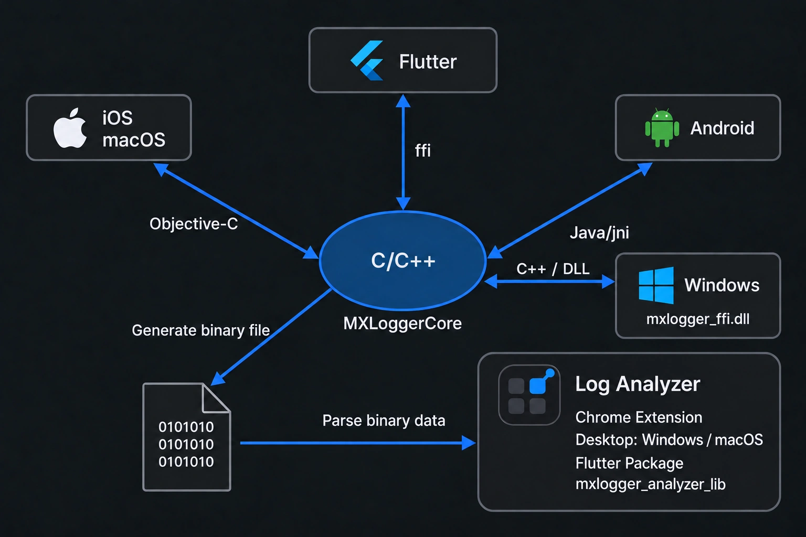

# flutter_mxlogger

[English](./README.md) | 简体中文 | [日本語](./README_JA.md) | [한국어](./README_KO.md)

MXLogger 是基于 mmap 内存映射机制的跨平台日志库，支持 AES CFB 128 位加密。核心用 C/C++ 实现，序列化使用 Google FlatBuffers，Flutter 端通过 `dart:ffi` 直接调用，性能几乎与原生一致。

更多说明见 [MXLogger 主仓库](https://github.com/coder-dongjiayi/MXLogger)。

- **当前版本**：2.3.0
- **环境要求**：Dart SDK `>=2.19.0 <4.0.0`、Flutter `>=3.7.0`
- **平台支持**：iOS（>= 9.0）、macOS（>= 10.14）、Android（minSdk 21）、Windows 10/11 x64

## 目录

- [安装](#安装)
- [快速开始](#快速开始)
- [一、各平台运行机制](#一各平台运行机制)
  - [1.1 整体结构](#11-整体结构)
- [二、Dart API](#二dart-api)
  - [2.1 初始化](#21-初始化)
  - [2.2 存储策略 `MXStoragePolicyType`](#22-存储策略-mxstoragepolicytype)
  - [2.3 写日志](#23-写日志)
  - [2.4 开关与等级](#24-开关与等级)
  - [2.5 磁盘管理](#25-磁盘管理)
  - [2.6 状态查询](#26-状态查询)
  - [2.7 写入失败的兜底记录](#27-写入失败的兜底记录)
  - [2.8 解析日志文件](#28-解析日志文件)
  - [2.9 销毁](#29-销毁)
- [三、`loggerToken`：跨模块、跨语言共用一个 logger](#三loggertoken跨模块跨语言共用一个-logger)
  - [3.1 它是什么](#31-它是什么)
  - [3.2 子模块写日志（Dart）](#32-子模块写日志dart)
  - [3.3 原生代码写日志（Android / iOS）](#33-原生代码写日志android--ios)
  - [3.4 生命周期](#34-生命周期)
- [四、解析 `.mx` 日志文件](#四解析-mx-日志文件)
  - [4.1 文件在哪](#41-文件在哪)
  - [4.2 Chrome 扩展与桌面解析器（macOS / Windows / Linux）](#42-chrome-扩展与桌面解析器macos--windows--linux)
    - [4.2.1 Chrome 扩展](#421-chrome-扩展)
    - [4.2.2 桌面 app](#422-桌面-app)
    - [4.2.3 导入与检索日志](#423-导入与检索日志)
  - [4.3 App 内嵌解析器（`mxlogger_analyzer_lib`）](#43-app-内嵌解析器mxlogger_analyzer_lib)
  - [4.4 用 Dart 解析](#44-用-dart-解析)
- [示例工程](#示例工程)
- [License](#license)

## 安装

```yaml
dependencies:
  flutter_mxlogger: ^2.3.0
```

原生 SDK 依赖会自动引入：

- iOS / macOS（CocoaPods）：依赖 `MXLogger 2.3.0` → `MXLoggerCore 2.3.0`
- iOS / macOS（Swift Package Manager）：宿主 App 开启了 Flutter 的 SwiftPM 支持（`flutter config --enable-swift-package-manager`）时，插件通过 `darwin/flutter_mxlogger/Package.swift` 接入，改为依赖 [mxlogger-spm](https://github.com/coder-dongjiayi/mxlogger-spm) `2.3.0`
- Android：Gradle 依赖 `io.github.coder-dongjiayi:mxlogger:2.3.0`
- Windows：准备好的插件包自带预编译 x64 `mxlogger_ffi.dll`，CMake 检查版本及 SHA-256 后随应用复制 DLL。Debug 使用 Debug DLL，Profile/Release 使用 Release DLL；Flutter 用户无需编译 Core 或安装 NuGet。

### Windows 预编译 DLL 与本地开发

仓库在 `windows/bin/x64/` 保存预编译 DLL 和 manifest，不保存 Windows Core 源码副本。
修改 Core 后，手动运行 `verify-logger`：
Windows CI 从当前提交构建 `Core/ffi`，执行真实 Dart FFI 测试，最后产出
`MXLogger.Native.2.3.0.nupkg` 和已装入两种 DLL 的 `flutter_mxlogger-windows-prebuilt` 插件包。
不需要发布到 NuGet 公共仓库，也不需要自己有 Windows 电脑。

在 **Mac 或 Windows** 的仓库中使用，下载这个 nupkg 后执行：

```bash
python3 scripts/prepare_flutter_windows.py --package /path/to/MXLogger.Native.2.3.0.nupkg
python3 scripts/prepare_flutter_windows.py --check
```

脚本只提取约定的文件，检查包 ID、Core/ABI 版本、DLL 架构和哈希，放入 `windows/bin/x64/`。
**发布 pub 前必须先准备这些文件**，将两个 DLL 和 manifest 一起提交到 Git；pub 包也会包含它们。
缺少 DLL 或校验不符时，CMake 会明确报错。以后修改 Core，需要重新跑 CI 并导入新包，DLL 才会更新。

`MXLOGGER_LOCAL_NATIVE` 继续用于 Android/Apple 的本地原生依赖，Windows 始终使用二进制。
也可将 `MXLOGGER_WINDOWS_BINARY_DIR` 指向已还原 NuGet 包的 `build/native/ffi/x64`，
目录需包含 manifest 和 Debug/Release 两种 DLL。
`scripts/sync_flutter_native.py` 仅同步 Apple 共用的 C ABI/内存辅助头文件，CI 用 `--check` 检查一致性。
Windows 默认目录为 `%LOCALAPPDATA%/MXLogger/<可执行文件名>/<nameSpace>`，
与 macOS 一样手动清理。分发应用时保留完整 Flutter 构建目录，包括 DLL、Flutter 运行库和 `data/`。

在安装 VS 2022/v143、PowerShell 7、Python、NuGet CLI 和 Flutter 的 Windows 仓库根目录运行：

```powershell
pwsh -File scripts/verify_flutter_windows.ps1 -Configuration Debug
pwsh -File scripts/verify_flutter_windows.ps1 -Configuration Release
```

测试从当前源码制作本地 NuGet 测试包，只从本地源还原并禁用缓存，再检查导出符号、真实 Dart 读写/加密/内存释放，
以及移出仓库后的 Flutter 程序和多 isolate 写入。消费端只有 DLL，没有相邻 Core 源码，也不设置二进制路径覆盖。
Windows 原生代码若要共享 Dart 的 token，应调用同一个 DLL 的 C 接口；另行静态链接的 Core 有独立实例表。
这次新增的 Dart 原生释放接口，需要 Android/Apple 原生桥接在发布 2.3.0 时一起升级。

iOS / macOS 共用 `darwin/` 实现（`sharedDarwinSource`，Flutter 3.7+）。Flutter 3.44+ 默认使用 SwiftPM，CocoaPods 仍受支持。macOS 默认目录为 `<Application Support>/<bundle-id>/MXLogger/<nameSpace>`，没有 bundle ID 时使用进程名；沙盒应用的 Application Support 位于容器内。macOS 清理需显式调用 `removeExpireData()`。

### Apple release 归档：保留 FFI 符号

在宿主应用的 **Runner** target 中，将 Release 和 Profile 的
**Build Settings > Strip Style** 设置为 **Non-Global Symbols**
（`STRIP_STYLE = non-global`）。示例已在 `example/ios/Flutter/Release.xcconfig`
及 `example/macos/Runner/Configs/Release.xcconfig`
中设置，Release / Profile 均使用对应文件。其他宿主应用需在对应的 release 配置中添加该设置，
或直接在 Runner target 上设置。

使用 SwiftPM 静态链接时，`DynamicLibrary.process()` 会从应用可执行文件中查找
`flutter_mxlogger_*` C 函数。桥接层已经使用 `extern "C"`、默认可见性、`used`
以及插件注册时调用的锚点函数。这些措施会在编译和链接阶段保留函数，但如果
**Strip Style** 为 **All Symbols**，最终归档的符号裁剪步骤仍可能删除全局符号名。
因此可能出现 Debug 正常，而安装 IPA 后报
`Failed to lookup symbol 'flutter_mxlogger_initialize'` 的情况。

release 构建后，可检查归档中的应用：

```bash
xcrun nm -gU build/ios/archive/Runner.xcarchive/Products/Applications/Runner.app/Runner | rg ' _flutter_mxlogger_initialize$'
```

修改宿主配置后，需要重新构建并导出 IPA。参见 Flutter 官方的
[FFI 符号裁剪说明](https://docs.flutter.dev/platform-integration/legacy-ffi-plugin#stripping-symbols)。

## 快速开始

```dart
import 'package:flutter_mxlogger/flutter_mxlogger.dart';

final logger = await MXLogger.initialize(
  nameSpace: "flutter.mxlogger",
  storagePolicy: MXStoragePolicyType.yyyyMMddHH,
  consoleEnable: true,
  cryptKey: "abcuioqbsdguijlk",   // 16 字节
  iv: "bccuioqbsdguijiv",         // 不传则与 cryptKey 相同
);

logger.setMaxDiskAge(60 * 60 * 24 * 7); // 最多保留 7 天
logger.setMaxDiskSize(1024 * 1024 * 10); // 最多占用 10MB
logger.setLevel(0);                      // 0:debug 以上全部写文件

logger.debug("this is debug message", name: "mxlogger", tag: "net,response");
logger.info("this is info message", name: "mxlogger", tag: "tag1,tag2");
logger.warn("this is warn message");
logger.error("this is error message");
logger.fatal("this is fatal message");
```

---

# 一、各平台运行机制

## 1.1 整体结构



Flutter 通过 `dart:ffi` 调用 Core：Apple 使用 Objective-C 桥接，Android 与 Windows 共用 C++ FFI 桥接，Windows 加载 `mxlogger_ffi.dll`。解析器提供 Chrome 扩展、Windows/macOS 桌面应用，以及 `mxlogger_analyzer_lib` Flutter package 集成。

关键点：**日志写入路径上没有 MethodChannel**。`log()` 从 Dart 到磁盘全程是 FFI 同步调用，不经过消息队列、不产生 codec 编解码，也不需要等待平台线程调度。

---

# 二、Dart API

## 2.1 初始化

### `MXLogger.initialize`（推荐）

```dart
static Future<MXLogger> initialize({
  required String nameSpace,
  String? directory,
  bool consoleEnable = false,
  MXStoragePolicyType storagePolicy = MXStoragePolicyType.yyyyMMdd,
  String? fileName,
  String? fileHeader,
  String? cryptKey,
  String? iv,
})
```

| 参数 | 说明 |
|---|---|
| `nameSpace` | 日志命名空间，建议用域名反转保证唯一。最终目录为 `directory/nameSpace` |
| `directory` | 自定义目录。不传则通过 MethodChannel 取平台默认路径：iOS `<Library>/com.mxlog.LoggerCache`、Android `<filesDir>/com.mxlog.LoggerCache`、macOS `<Application Support>/<bundle-id>/MXLogger` |
| `consoleEnable` | 是否开启控制台打印，仅 debug 构建有效 |
| `storagePolicy` | 文件切分策略，见 2.2 |
| `fileName` | 自定义文件名，默认 `mxlog` |
| `fileHeader` | 文件头信息，文件**创建时**写入一次。适合放 App 版本、平台、设备型号等上下文 |
| `cryptKey` | AES 密钥。**16 字节：超长截断，不足补 0**。不传则不加密 |
| `iv` | 初始化向量，规则同 `cryptKey`。不传则与 `cryptKey` 相同 |

> ⚠️ `cryptKey` / `iv` 不足 16 字节时补 0 的行为在 v2.0.0 才修复完整。用短 key 写出的旧日志解析器可能读不出来，建议直接用满 16 字节。

### 同步构造函数

```dart
MXLogger({required String nameSpace, required String directory, ...})
```

`directory` 必传，不走 MethodChannel，可同步调用。

**初始化失败时不会抛异常**：native 返回空句柄（比如目录创建不了），实例会被自动置为 `enable == false`，后续所有调用安全短路，不会把空指针带进 native。可以通过 `logger.enable` 判断。

## 2.2 存储策略 `MXStoragePolicyType`

| 枚举值 | 切分粒度 | 文件名示例 |
|---|---|---|
| `yyyyMMdd`（默认） | 按天 | `2023-01-11_mxlog.mx` |
| `yyyyMMddHH` | 按小时 | `2023-01-11-15_mxlog.mx` |
| `yyyyWw` | 按周 | `2023-01-02w_mxlog.mx`（`02w` = 当年第 2 周） |
| `yyyyMM` | 按月 | `2023-01_mxlog.mx` |

## 2.3 写日志

### 实例方法

```dart
int debug(String msg, {String? name, String? tag});
int info (String msg, {String? name, String? tag});
int warn (String msg, {String? name, String? tag});
int error(String msg, {String? name, String? tag});
int fatal(String msg, {String? name, String? tag});

int log(int lvl, String msg, {String? name, String? tag});
```

- `lvl`：`0` debug、`1` info、`2` warn、`3` error、`4` fatal
- `name`：日志名称，通常放模块名
- `tag`：标记，多个用逗号分隔（`"net,response"`），解析器里可按 tag 过滤
- `msg` 若是合法 JSON，控制台会自动格式化缩进输出

**返回值**：

| 值 | 含义 |
|---|---|
| `0` | 成功 |
| `-1` | 文件扩容失败 |
| `-2` | 解除映射失败 |
| `-3` | mmap 映射失败 |

### 类方法（组件化场景）

大型 App 拆成多个模块时，子模块往往不方便持有 logger 对象。这时只需传递 `loggerToken` 字符串：

```dart
// 主工程
final token = logger.loggerToken;   // 保存起来，或注册到全局服务

// 子模块，不依赖 logger 实例
MXLogger.infoLog(token, "module message", name: "user_module", tag: "login");
```

```dart
static void logLoggerToken(String? loggerToken, int lvl, String msg, {String? name, String? tag});
static void debugLog(String? loggerToken, String msg, {String? name, String? tag});
static void infoLog (String? loggerToken, String msg, {String? name, String? tag});
static void warnLog (String? loggerToken, String msg, {String? name, String? tag});
static void errorLog(String? loggerToken, String msg, {String? name, String? tag});
static void fatalLog(String? loggerToken, String msg, {String? name, String? tag});
```

同一个 `loggerToken` 在原生侧也能用——Android 走 `FlutterMxloggerPlugin.info(...)`，iOS 走 `[FlutterMxloggerPlugin info:...]`，写进的是同一份文件。token 是什么、有效期多长、原生侧怎么用，见[第三章](#三loggertoken跨模块跨语言共用一个-logger)。

## 2.4 开关与等级

```dart
void setLevel(int lvl);        // 只有 >= lvl 的日志写入文件
void setEnable(bool enable);   // 总开关，false 时完全不写
void setConsoleEnable(bool enable);
void shouldRemoveExpiredDataWhenEnterBackground(bool should); // 默认 true
```

- `setLevel(2)` 表示 warn 及以上才落盘，debug/info 被丢弃。**注意这个开关不影响控制台**，控制台仍会打印全部等级。
- `setConsoleEnable` 写的是一个**静态字段**，对所有 logger 实例全局生效；新建 logger 时传入的 `consoleEnable` 同样会覆盖全局值。

> 🔁 从 1.x 迁移：旧版的 `setFileLevel(int)` 已更名为 `setLevel(int)`，语义不变。

## 2.5 磁盘管理

```dart
void setMaxDiskAge(int seconds);  // 默认 0 = 不限制
void setMaxDiskSize(int bytes);   // 默认 0 = 不限制

void removeExpireData();      // 按上面两个阈值清理
void removeBeforeAllData();   // 删除除当前写入文件外的所有日志
void removeAll();             // 清理闲置日志，保留正在使用的文件
```

`removeExpireData()` 的清理顺序：先按最后修改时间删掉超过 `maxDiskAge` 的文件；若总大小仍超过 `maxDiskSize`，再从最旧的开始继续删。**当前正在写入的文件永远不会被删除。**

iOS / Android App 进入后台时会自动调用，可通过 `shouldRemoveExpiredDataWhenEnterBackground(false)` 关闭。macOS 必须手动调用 `removeExpireData()`，后台清理开关在 macOS 上不生效。

## 2.6 状态查询

`MXLogger.coreVersion()` 返回当前链接的 C++ Core 版本（目前为 `2.3.0`），无需初始化 logger。
该值与 pub 包版本号独立；Web 没有原生 Core，调用时抛出 `UnsupportedError`。

| 成员 | 类型 | 说明 |
|---|---|---|
| `enable` | `bool` | 日志写入是否可用 |
| `consoleEnable` | `bool` | 控制台开关（全局） |
| `loggerToken` | `String?` | 底层唯一标识，用于组件化传递 |
| `diskcachePath` | `String` | 日志目录（`directory` + `nameSpace`） |
| `diskcacheErrorPath` | `String` | 错误记录文件路径，即 `diskcachePath/error.txt` |
| `logSize` | `int` | 已存日志总字节数 |
| `logFiles` | `List<MXFileEntity>` | 日志文件列表 |
| `errorDesc` | `String?` | 最近一次写入失败的描述，无错误返回 `null` |
| `cryptKey` / `iv` | `String?` | 初始化时传入的加密参数 |

### `MXFileEntity`

```dart
class MXFileEntity {
  String? name;          // 文件名
  int size;              // 字节数
  int createTimeStamp;   // 创建时间戳（秒）
  int lastTimeStamp;     // 最后修改时间戳（秒）

  DateTime get createTime;
  DateTime get lastTime;
}
```

## 2.7 写入失败的兜底记录

`log()` 返回非 0 时，日志本身没写进去，此时可以把失败信息记到一个独立的纯文本文件里，方便事后排查：

```dart
final code = logger.error("something went wrong");
if (code != 0) {
  logger.writeFail(
    code: code,
    errorDesc: logger.errorDesc ?? "",
    other: "userId=$userId",
  );
}
```

内容以 JSON 行追加写入 `diskcacheErrorPath`：

```json
{"code":-3,"error":"mmap failed","other":"userId=123"}
```

```dart
void writeFail({required int code, required String errorDesc, String? other});
void deleteFailFile();  // 删除错误文件
void closeFailFile();   // 关闭写入流
```

> 路径无效（未初始化 / 已禁用 / 已销毁）时 `writeFail` 直接返回，不会误写到根目录。

## 2.8 解析日志文件

```dart
static List<Map<String, dynamic>> selectLogmsg({
  required String diskcacheFilePath,
  String? cryptKey,
  String? iv,
});
```

传入日志文件的完整路径和写入时用的加密参数（未加密则不传）。返回**时间倒序**（最新在前）的条目列表，每条包含：

| 字段 | 说明 |
|---|---|
| `name` | 日志名称 |
| `tag` | 标记 |
| `msg` | 日志内容 |
| `level` | 等级 |
| `timestamp` | 时间戳 |
| `thread_id` | 线程 id |
| `is_main_thread` | 是否主线程 |
| `error_code` | `"1"` 表示该条解析失败，通常是 `cryptKey`/`iv` 不对 |

这是同步的 FFI 调用，文件较大时会阻塞。建议放到 isolate 里：

```dart
final records = await Isolate.run(() => MXLogger.selectLogmsg(
      diskcacheFilePath: path,
      cryptKey: key,
      iv: iv,
    ));
```

配合 `logFiles` 就能在 App 内做一个日志查看器（example 里的 `log_viewer_page.dart` 就是这么实现的）。不想自己写界面的话，[第四章](#四解析-mx-日志文件)介绍了 Chrome 扩展、桌面解析器和 App 内嵌解析器。

> `selectLogfiles({required String directory})` 目前是未实现的占位接口，所有平台都返回空列表，请勿使用。

## 2.9 销毁

```dart
static void destroy({required String nameSpace, String? directory});
static void destroyWithLoggerToken(String loggerToken);
```

销毁会先失效对应的 Dart 实例（移除生命周期监听、关闭错误文件流、清空 native 句柄），再释放 native 对象。

这个顺序是必要的：如果先释放 native，App 随后进入后台触发的清理回调就会拿着已释放的指针调进 native，造成 use-after-free 崩溃。

同一 `nameSpace + directory` 重复构造出的多个 Dart 实例共享同一个 native 对象，`destroy` 会把它们**全部**失效，不会漏掉先前的实例。

---

# 三、`loggerToken`：跨模块、跨语言共用一个 logger

## 3.1 它是什么

`loggerToken` 是一个标识底层 logger 的字符串，由 C++ 核心根据日志目录算出：`md5(directory/nameSpace)`，也就是 `diskcachePath` 的 MD5。由此带来三个特性：

- 同样的 `nameSpace` + `directory` 永远得到同一个 token，每次启动一样，iOS 和 Android 也一样；目录不同 token 就不同。
- 核心维护一张全局表 `token → logger`，所有接受 token 的接口都从这张表里查 logger，所以 token 只在该 logger 已在当前进程初始化时才有效。
- 它不是密钥，和 `cryptKey` / `iv` 没有任何关系，可以随意保存、传递、打印。

通过 `logger.loggerToken`（或 `getLoggerToken()`）读取。实例已失效时返回 `null`，例如初始化失败（2.1）。

## 3.2 子模块写日志（Dart）

组件化 App 里 logger 由主工程创建，目录和加密参数只有主工程知道，子模块不应该依赖这些。把 token 交给子模块，用 2.3 列出的类方法写即可：

```dart
// 主工程：初始化一次，把 token 发布出去
final logger = await MXLogger.initialize(nameSpace: "com.example.app", cryptKey: key, iv: iv);
AppServices.loggerToken = logger.loggerToken;   // 任意服务定位器 / DI 容器都行

// 子模块：完全不知道 MXLogger 是怎么配置的
MXLogger.infoLog(AppServices.loggerToken, "user tapped pay", name: "pay", tag: "ui");
MXLogger.errorLog(AppServices.loggerToken, "payment failed: $error", name: "pay", tag: "order");
```

所有日志写进同一个文件，等级过滤、加密、控制台开关都跟主工程的实例保持一致。token 为 `null` 或查不到时类方法直接丢弃这条日志，不会抛异常。

## 3.3 原生代码写日志（Android / iOS）

token 是在共用的 C++ 核心里算出来的，所以原生层认的是同一个字符串。用你自己的通道（MethodChannel、Pigeon、原生单例……）把它传过去，就能直接写进 Flutter 这个 logger 的文件：

```java
// Android：com.coderdjy.mxlogger.FlutterMxloggerPlugin
FlutterMxloggerPlugin.info(loggerToken, /*tag*/ "network", /*name*/ "okhttp", /*msg*/ "GET /user 200");
```

```objc
// iOS：FlutterMxloggerPlugin.h
[FlutterMxloggerPlugin info:loggerToken name:@"URLSession" msg:@"GET /user 200" tag:@"network"];
```

注意参数顺序不同：Android 是 `(token, tag, name, msg)`，iOS 是 `(token, name, msg, tag)`。两端都有 `debug` / `info` / `warn` / `error` / `fatal`。如果原生代码本来就集成了 MXLogger SDK，也可以直接用 SDK 自己的 token 接口：Android `MXLogger.log(token, tag, level, name, msg)`，iOS `[MXLogger infoWithLoggerToken:name:msg:tag:]`（Swift：`MXLogger.info(loggerToken:name:message:tag:)`）。

## 3.4 生命周期

- token 从 `MXLogger.initialize` 起有效，到 `destroy` / `destroyWithLoggerToken`（2.9）失效。同样的 `nameSpace` + `directory` 构造两次会复用同一个底层 logger，两个 Dart 实例拿到的 token 相同。
- `MXLogger.destroyWithLoggerToken(token)` 是给只持有字符串的代码用的销毁方式：先失效该 token 对应的全部 Dart 实例（`enable` 变为 `false`，之后的调用都是空操作），再释放底层对象；此后用这个 token 写的日志会被丢弃。
- 用同样参数重新初始化后 token 字符串完全一样，写入随即恢复。所以保存下来的 token 跨启动不会过期，但必须等主工程在本进程里初始化过 logger 才能用。

速查：

| 需求 | 接口 |
|---|---|
| 获取 token | `logger.loggerToken` |
| Dart 写日志 | `MXLogger.debugLog / infoLog / warnLog / errorLog / fatalLog(token, msg, name:, tag:)`、`MXLogger.logLoggerToken(token, lvl, msg, name:, tag:)` |
| Android 写日志 | `FlutterMxloggerPlugin.debug / info / warn / error / fatal(token, tag, name, msg)` |
| iOS 写日志 | `[FlutterMxloggerPlugin debug / info / warn / error / fatal:token name: msg: tag:]` |
| 按 token 销毁 | `MXLogger.destroyWithLoggerToken(token)` |

# 四、解析 `.mx` 日志文件

`.mx` 不是文本文件：每条记录是一个 flatbuffer，初始化时传了 `cryptKey` / `iv` 的话整个文件还经过 AES-CFB-128 加密，用编辑器打开只能看到乱码。有四种读取方式，按场景选：

| 场景 | 用哪个 |
|---|---|
| 在 Chrome 浏览器中解析 `.mx` 日志 | [4.2.1 Chrome 扩展](#421-chrome-扩展) |
| 在桌面 app 中分析导出的日志文件 | [4.2.2 桌面 app](#422-桌面-app) |
| 测试时直接在手机上看日志，不连电脑 | [4.3 App 内嵌解析器](#43-app-内嵌解析器mxlogger_analyzer_lib) |
| 自己用 Dart 做查看界面或上传管道 | [4.4 用 Dart 解析](#44-用-dart-解析) |

## 4.1 文件在哪

- **目录**：`logger.diskcachePath`，即 `directory/nameSpace`。使用默认目录时，iOS 是 `<Library>/com.mxlog.LoggerCache/<nameSpace>`，Android 是 `<filesDir>/com.mxlog.LoggerCache/<nameSpace>`（`/data/data/<package>/files/...`）。
- **文件名**由存储策略决定（2.2），如 `2023-01-11_mxlog.mx`。同目录下的 `error.txt`（2.7）是纯文本，不需要解析器。
- **在 Dart 里列出**：`logger.logFiles` 返回 `MXFileEntity(name, size)`，完整路径是 `"${logger.diskcachePath}/${file.name}"`。

把文件拿到电脑上：

- **iOS 真机**：Xcode > Window > Devices and Simulators > 选中设备和 App > ⚙︎ > *Download Container…*。右键 `.xcappdata` > *显示包内容* > `AppData/Library/com.mxlog.LoggerCache/<nameSpace>/`。
- **iOS 模拟器**：

  ```bash
  open "$(xcrun simctl get_app_container booted <bundle id> data)/Library/com.mxlog.LoggerCache/<nameSpace>"
  ```

- **Android**（debug 包；该目录是 App 私有目录）：

  ```bash
  adb shell run-as <package> ls files/com.mxlog.LoggerCache/<nameSpace>
  adb exec-out run-as <package> cat files/com.mxlog.LoggerCache/<nameSpace>/2023-01-11_mxlog.mx > 2023-01-11_mxlog.mx
  ```

- **Release 包 / 真实用户**：需要 App 自己把文件交出来，例如用 `share_plus` 分享，或上传到你的服务器，路径来自 `logFiles`。logger 仍在写入时也可以直接拷贝文件，下面的内嵌解析器就是这样读取当前目录的。

## 4.2 Chrome 扩展与桌面解析器（macOS / Windows / Linux）

### 4.2.1 Chrome 扩展

通过 Chrome 中的 **MXLogger Analyzer**，可以解析从 iOS、macOS 或 Android app 导出的 `.mx` 日志：

1. 在 Chrome 中打开 [Chrome 应用商店页面](https://chromewebstore.google.com/detail/mxlogger-analyzer/bpjhmakllccpeiglbfngmdbelimlghfi)，点击「添加至 Chrome」→「添加扩展程序」。
2. 打开 Chrome 扩展菜单，点击 **MXLogger Analyzer**，解析器会在新标签页中打开；也可以将扩展固定到工具栏，方便下次使用。
3. 选择或拖入按 [4.1](#41-文件在哪) 获取的一个或多个 `.mx` 文件，按[下方导入步骤](#423-导入与检索日志)操作。加密日志填写写入时使用的 `cryptKey` / `iv`，未加密日志两项均留空。

解析和解密均在浏览器本地执行，安装后可离线使用，日志和解密密钥不会上传到服务器。导入的日志缓存在扩展自己的本地存储中，刷新页面后仍可查看。KEY/IV 默认只保留在当前标签页会话中；如需下次继续使用，可勾选「在此浏览器保存 KEY 和 IV」。

重新解析时需要再次选择原始 `.mx` 文件，并重新填写未保存的解密参数。需要移除日志缓存时，使用解析器中的清除数据操作。

### 4.2.2 桌面 app

到 [Releases](https://github.com/coder-dongjiayi/MXLogger/releases) 下载对应 macOS、Windows 或 Linux 的 `mxlogger_analyzer`，启动后按下方相同的步骤导入日志。

### 4.2.3 导入与检索日志

Chrome 扩展和桌面 app 均使用三步导入向导：

1. **选文件**：把一个或多个 `.mx` 文件拖到窗口里，或点击选择。
2. **解密**：填入初始化 logger 时用的 `cryptKey` / `iv`；未加密就都留空。中途换过密钥的话把每一组都加上，会按勾选框里的序号依次尝试，直到解开为止。Chrome 扩展默认只在当前会话保留 KEY/IV，可勾选本地保存以便下次使用。
3. **导入**：真实进度条（按字节解析、按条数写库），完成后自动进入数据页。

数据页顶部显示总条数、起止时间和文件名；下面是可点击过滤的等级分布条和 DEBUG–FATAL 等级 chips、关键字搜索（全部 / 内容 / tag / name）加时间范围过滤、点任意卡片上的 `@name` 或 `#tag` 即可按其过滤、JSON 内容以语法着色树展示、单条全屏详情（Esc 关闭），分享按钮可导出 `.txt`。更换文件、修改密钥、清除数据都在顶部菜单里。

解析失败会退回第 2 步，基本都是 `cryptKey` / `iv` 填错。v2.0.0 之前用不足 16 字节的密钥写出的日志可能解不开（见 2.1 的提示）。

截图和完整功能列表见仓库 [README](https://github.com/coder-dongjiayi/MXLogger/blob/main/README_CN.md#日志解析器)。

## 4.3 App 内嵌解析器（`mxlogger_analyzer_lib`）

解析器内核同时也是一个 Flutter package。它在 App 的 `Overlay` 上挂一个可拖动的悬浮球，点一下弹出底部面板，按需解析 `diskcachePath`，测试同学不连电脑就能在手机上看日志。

```yaml
dependencies:
  mxlogger_analyzer_lib: last
```

```dart
import 'package:mxlogger_analyzer_lib/mxlogger_analyzer_lib.dart';

final navigatorKey = GlobalKey<NavigatorState>();
// MaterialApp(navigatorKey: navigatorKey, ...)

await MXAnalyzer.showDebug(
  navigatorKey.currentState!.overlay!,
  diskcachePath: logger.diskcachePath,
  // 所有解密参数组，按顺序尝试；未加密传 []
  cryptPairs: [
    MxCryptPair(key: logger.cryptKey ?? "", iv: logger.iv ?? ""),
    // MxCryptPair(key: "legacy-key", iv: "legacy-iv"),
  ],
  // 分享由宿主接入（share_plus、自己的上传接口……），返回 false 则退化为复制到剪贴板
  onShare: (MXShareRequest request) async => false,
);

MXAnalyzer.dismiss(); // 移除悬浮球并释放数据库
```

这是调试工具，建议只在 debug 开关打开时挂载，不要带给最终用户。完整 API 和移动端适配说明见 [mxlogger_analyzer_lib README](https://github.com/coder-dongjiayi/MXLogger/blob/main/mxlogger_analyzer/mxlogger_analyzer_lib/README.zh-CN.md)。

## 4.4 用 Dart 解析

`MXLogger.selectLogmsg`（2.8）把一个文件解成 `List<Map<String, dynamic>>`，字段与解析器展示的一致。想自己做界面，或者上传前转成 JSON / 文本，用它即可。它是同步 FFI 调用，请放在 isolate 里执行；example 里的 `log_viewer_page.dart` 是完整参考。

# 示例工程

`example/` 是一个完整的演示 App，覆盖了本文档提到的全部 API：初始化、五个等级写入、loggerToken 组件化写入、磁盘策略、文件列表、日志查看与解析、销毁。

```bash
cd example && flutter run
```

# License

BSD 3-Clause，见 [LICENSE](LICENSE)。
