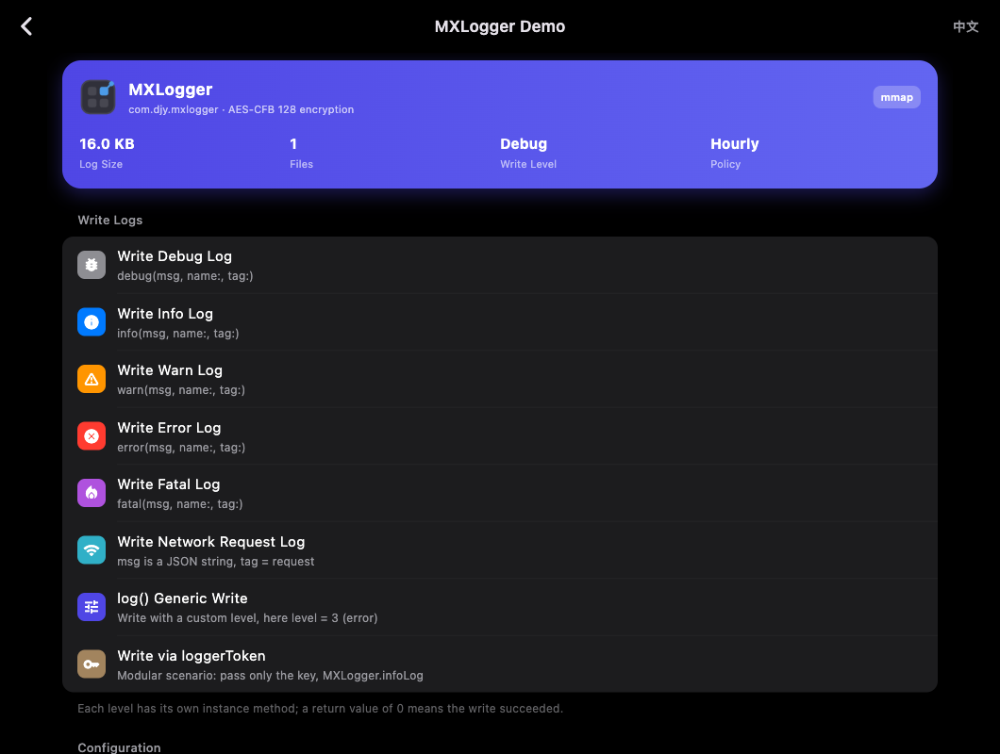

# MXLogger Flutter demo — iOS / Android / macOS

The example uses the plugin from the parent directory. The plugin requires
Flutter 3.7+, while this example's dependencies require Dart 3.8+.

The macOS demo reuses the same landing page, grouped feature console, file list,
encrypted log viewer and English/Chinese switching as the mobile examples. It adds
a resizable desktop window, readable content width, dialog-based settings, a
separate **Open in Finder** row, and explicit cleanup instructions. The background
cleanup switch is hidden on macOS. Release/profile builds disable the console switch.

Defaults match the native demos: namespace `com.djy.mxlogger`, hourly files,
AES-CFB-128, seven-day retention and a 10 MB disk budget. Features include all five
levels, JSON/generic/token writes, configuration, a 100,000-write benchmark,
concurrent isolates with count/order verification, manual cleanup, rebuilding,
file browsing, level/keyword filters and copying full log messages. Isolates share
one process; the separate native macOS demo also demonstrates multiple processes.

## Run the unpublished macOS demo

From the repository root, with Flutter, Xcode and CocoaPods installed:

```bash
bash scripts/run_flutter_macos_demo.sh
# If Flutter is not on PATH:
FLUTTER_BIN=/path/to/flutter/bin/flutter bash scripts/run_flutter_macos_demo.sh
```

This starts the actual `lib/main.dart` app using this checkout's native CocoaPods.
It scopes `MXLOGGER_LOCAL_NATIVE=1` and `FLUTTER_SWIFT_PACKAGE_MANAGER=false` to the
command, without changing Flutter's global settings or requiring published 2.2.0
dependencies. The demo's CocoaPods setup generates an ignored
`macos/Runner/Configs/SDK.xcconfig` to match the installed Xcode SDK's build floor;
the plugin's declared macOS minimum remains 10.14.

Build the actual demo in Release, or exercise its desktop UI and save previews:

```bash
bash scripts/run_flutter_macos_demo.sh build --release
bash scripts/run_flutter_macos_demo.sh test
```

The UI check uses a temporary log directory and covers settings, all write APIs,
concurrent isolates, navigation, localization and filtering. Its previews are
rendered from the app's own widget tree and saved to `screenshots/macos-*.png`.



## Published dependencies and plugin checks

Once native dependencies are published, run from this directory:

```bash
flutter pub get
flutter run -d macos
```

The native `MXLogger` / `MXLoggerCore` pods or `mxlogger-spm` package must be
available at version 2.2.0. For CocoaPods development before publication, set
`MXLOGGER_LOCAL_NATIVE=1` to use the native sources from this checkout. When
Flutter's SwiftPM integration is enabled, its package dependency must instead
be resolved to a local `mxlogger-spm` checkout for unpublished builds.

The macOS tests exercise the registered MethodChannel, default and custom
directories, encrypted FFI writes and reads, logger tokens, reopening, explicit
cleanup, and writes from secondary isolates:

```bash
flutter test integration_test/macos_logger_test.dart -d macos
```

Flutter integration tests run in Debug. Verify Release AOT and FFI symbol
retention with the separate entrypoint:

```bash
flutter build macos --release -t integration_test/macos_release_smoke.dart
build/macos/Build/Products/Release/example.app/Contents/MacOS/example
```

The Release check prints `MXLOGGER_MACOS_RELEASE_SMOKE_OK` and exits with code 0
after an encrypted write/read round trip. Both checks remove their test logs.
The Runner and its dependencies use the generated SDK configuration described above.
For SwiftPM builds with a newer Xcode SDK, set `MXLOGGER_DEMO_DEPLOYMENT_TARGET`
to a supported macOS version in `macos/Runner/Configs/SDK.xcconfig`, or use the
isolated regression fixtures below, which generate it automatically.

On macOS, `shouldRemoveExpiredDataWhenEnterBackground` has no effect. Call
`removeExpireData()` explicitly when your app wants to enforce its age and size
limits. Default logs are under `Application Support/<bundle-id>/MXLogger` (inside
the app container when sandboxing is enabled).

To run all checks against unpublished local native sources, use
`python3 scripts/verify_macos_support.py` from the repository root. It creates
isolated CocoaPods and SwiftPM fixtures and adjusts only their deployment targets
to the installed Xcode SDK. See the main repository's
[verification instructions](../../../README.md#macos-regression-checks-and-release-preparation).
